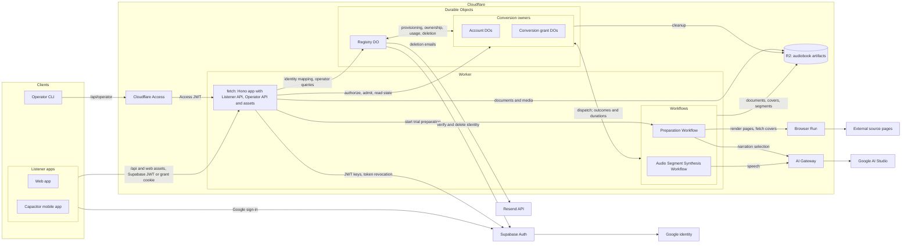
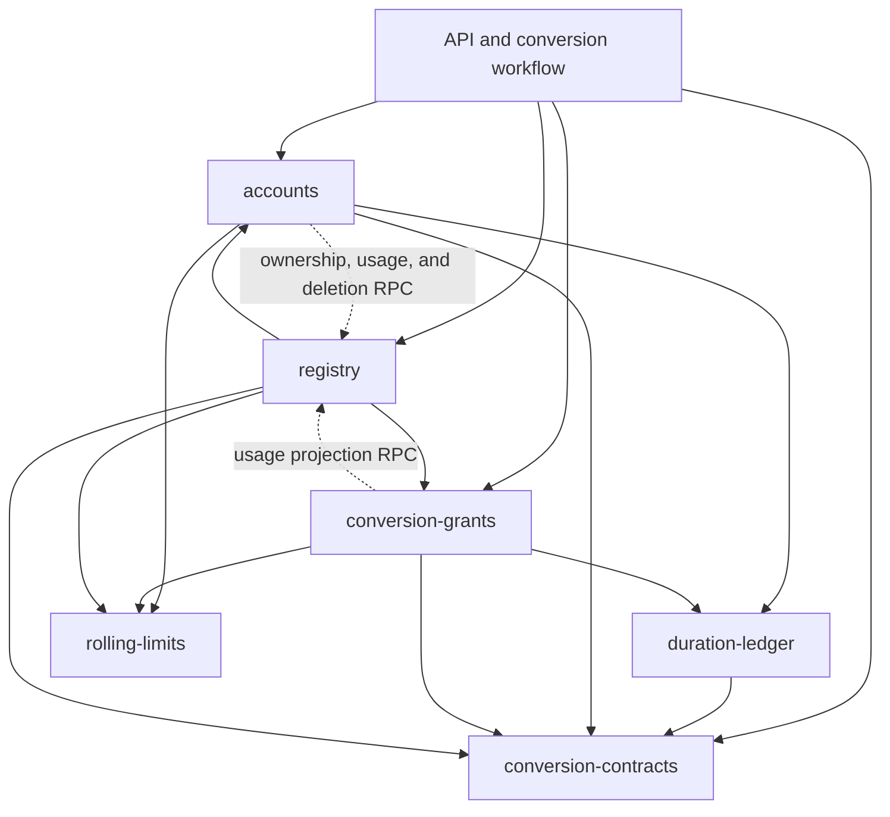

# System overview

Cup turns source content behind a URL into an audiobook. A shared web application runs in a browser and in Capacitor mobile shells. A Cloudflare Worker serves the web assets and APIs, while Cloudflare Workflows coordinates conversion and SQLite Durable Objects own mutable application state.

## Runtime map

[Open this diagram in Mermaid Live](https://mermaid.live/view#pako:eNptVdtu4zYQ_ZWBgAVaQMm6duKLWhRwk8U2ixRZJAUCVM4DJY1lNjLJkpQdb5x_75CUZNmJH8whdeZ-OHyNcllglETLSm7zFdMWbu8XAsDUWamZWkFecRTWpFdhfXIfAT59gi9FiQYqZBsEu-KmU4lBSAvcGloLNDEYCX-hXjNewDOiMv5bwTXmlkuRwCNmwJQCY9nOAMskWbxiiuXcSg1rmfEKHeA8-O5Cq7ixKFDPlTLpbbNxwDZKOHhp0nK_LWZp47LDCWb5BtOPvDYYFEUQpELNCJLeNQJc3d54UAPphwVnZ7_vPzPFgYnCeQZmDFoqykOtWMYMwrfHv4GMUErCQi7lM8c9LNHmqw-NfZWypMAML8UZF3tgtfXANqzO4-f2hDB5jsactFXWxbJimpLuxCbVAO-dw9yfPJ3Ufyv1M-r00S9dKX3oqf9P4E8ppO_tltsVdD2af7-Joasf7Xx5Qmk6Q0d-HD-Nd-WlDgSgNCpGhqjJ6feDDC22BzU7YVdouEnndcElPGC5JlLDQ3v-Xqlreyd0YcnsX-KWSa9rzTJqyV3Yv49fbilnqqcUG1pdbOGkFxmVXNbums2DANd3_c-eHEcWAl36qC5AAI0lVVrv0vtGIOApjfUw_el-mBB_qBIZ0Q7o8vMlowx-brCZpkqjvq9F-kcQgeTmY8ksbtkund_A1yAescfTMNDGMbzH6IYhHuDIKzX_gTGwYs1tTKGzwg0CS5cgVOlUhxfUMm53sCZecVHGB-r_V6PmaPZdAU51yTBNOKs5q_q82fc3pzqFzGvHEuM5usaCM3IwbKrYFvg3B1VabrhrTwjLh7_iKobasJJyLLDC4K-fWpCDhYIbxcjzryBrm8s1Bq9FHWKj1LrLcKTsdHOaxaJWh-A66HEeMU0ZRyMazIH_5qDSq4NX0sQXarui8AkfihK09z16fKwrmG52hvLOQ-INbZqr1N073xyFmK-OIA1bD54ckN6TWueYfnmxqAV1MuxDkJ6EjQUPZvzBOoqnzeAkvoYDjzy02Y3hZ9xRllY-o6DObmTesMPRNO0G9px2XrlrvtOnmvDlLnTLtRmhJephRrvVB1X6WNqQWuB7oy1hAOn1rDyxDdWE7rVb3OB8iuKo1LyIEqtrjKN1eGjpRX911hYRFXiNiyghUWNRv5zlspJ6ES3EG6kqJv6Rct1qa1mXqyhZssrQrlYFFfKaMxo2B4hnxJUbUlFy6S1EyWv0EiWj2flsejEYDCbj0WQynPwSR7soGV-czyYX08FwNpiNp6Ph-C2OfniXg_PZ5WgyG02no9FwNB7PLt_-B6Hm9XA)

The Worker is the HTTP boundary; its `fetch` handler is its only entry point, and the Worker has no queue or scheduled handler. Separate preparation and audio segment synthesis workflows perform durable conversion work inside the same Worker; account and conversion grant objects, the conversion owners, control ownership, allowance, and lifecycle, and dispatch the workflows. The shared registry also coordinates cleanup across R2 and Supabase and sends lifecycle notifications. Durable Object alarms take the place of a cron: they retry segment dispatch, usage projections, and deletion cleanup. The diagram groups resources by responsibility; a Durable Object class creates multiple isolated objects where required.

## Responsibilities and code boundaries

| Component                                 | Responsibility                                                                                 | Implementation                                                                                                                      |
| ----------------------------------------- | ---------------------------------------------------------------------------------------------- | ----------------------------------------------------------------------------------------------------------------------------------- |
| Web application                           | Conversion entry, account UI, playback, and session management                                 | [Web source](../../apps/web-app/), [screens](web-app.md)                                                                            |
| Native shells                             | Package the shared UI and supply platform sign-in, sharing, links, and media integration       | [Mobile guide](../../apps/mobile-app/README.md), [platform adapters source](../../apps/web-app/src/platform/)                       |
| Operator CLI                              | Administrative requests authenticated through Cloudflare Access                                | [Operator guide](../../apps/operator/README.md)                                                                                     |
| Worker and API server                     | Assets, domain routing, authentication, request validation, conversion admission, and delivery | [Worker entry source](../../apps/cloudflare-worker/src/index.ts), [API composition source](../../libs/api-server/src/api-server.ts) |
| Preparation Workflow                      | Source rendering, narration selection, document storage, and preparation outcomes              | [Preparation entry point](../../libs/create-audiobook-from-url-workflow/src/prepare-audiobook-workflow.ts)                          |
| Audio segment synthesis Workflow          | One segment's speech generation, artifact storage, and duration settlement                     | [Synthesis entry point](../../libs/create-audiobook-from-url-workflow/src/synthesize-audio-segment-workflow.ts)                     |
| Account and trial state                   | Ownership, history, duration accounting, synthesis dispatch, and lifecycle                     | [Storage ownership](#storage-ownership)                                                                                             |
| Source preparation                        | Render source pages, prepare audiobook source material, and fetch declared cover images        | [Preparation library](../../libs/prepare-source-material/)                                                                          |
| Narration selection and document creation | Select source material and structure narration text and synchronization units                  | [Selection library](../../libs/narration-content-selection/), [document creation library](../../libs/narration-document-creation/)  |
| Audiobook production                      | Store prepared narration and synthesize independently playable audio segments                  | [Audiobook production library](../../libs/audiobook-production/)                                                                    |

The libraries are code boundaries inside the deployed system, not separate network services. Each library's guide holds its details:

- [Accounts](../../libs/accounts/README.md): account conversion state, duration accounting, lifecycle transitions, and artifact fencing.
- [Conversion grants](../../libs/conversion-grants/README.md): trial grants.
- [Registry](../../libs/registry/README.md): account identity mapping and provisioning, grant inventory, conversion ownership for accounts and trials, ingress limits, and account deletion coordination. Owner objects call it through narrow RPC interfaces, and its integration tests exercise the three objects together.
- [Duration ledger](../../libs/duration-ledger/README.md): the allowance, reservation, and charge storage that accounts and grants share.
- [Conversion contracts](../../libs/conversion-contracts/README.md): runtime-independent shared schemas, types, and duration calculations; its [lint configuration](../../libs/conversion-contracts/oxlint.config.ts) refuses `cloudflare:` and `node:` imports, because the Worker, the workflows, and the browser load it.
- [Rolling limits](../../libs/rolling-limits/README.md): the rolling-window rate limiter, whose table each of the three objects keeps in its own database.
- [Errors](../../libs/errors/README.md): error helpers shared by server code, including the rule that server logs record only a caught error's root cause. It imports no Cup package, so the graph below leaves it out.

[Open this diagram in Mermaid Live](https://mermaid.live/view#pako:eJx1Us1qwzAMfhWhc9IHyGFQWhiFHcrYaUkPxlYdb44VFGfdKH33kZ92Schusr5fbF9RsyHM8Oz5okslEd72RQAA2B4P-fZ4ABUMaA5fJI3jABeWz458gjR9gq3W3IbY5GocTg9xjz-L6tA_fWr7zYL2StY1UX5yGYcFvuMQRem5k74vR_LdZFZsBRo6jQEjrQdeyFiS3LSiYhfg-_PoPqgmvGE9zPOSa9aucrHJhb13waa-P6449_uVzlNgZrwInXgtkJndv1U3wJdA0pSuTqBtlKWk_wCGPHV3Aq_HHWwmLzaP3QwaqIU_SK8KMMGKpFLOYIbXTl5gLKmiAjMoUMi036lmz1JgEW6YYFsbFWnvlBVVYRalpQStdAbDXKvwzvyAhFtbYnZWvqHbLxez9RM)

The owners reach the registry only through the RPC interfaces drawn as dashed lines, never as a package dependency: the registry depends on both owner libraries, so such a dependency would form a cycle, which every `turbo run` refuses. `pnpm boundaries` (`turbo boundaries`, part of `pnpm validate:fast`) also fails when a package imports a package its `package.json` does not declare, or a file outside its own directory.

Each package exposes its production code through its `.` export, so a caller sees one public interface per package; the [package export check](../../qa/workspace-checks/README.md) enforces this in `pnpm validate:fast` and lists the allowed exceptions. Accounts and conversion grants keep a few production subpaths, because their `.` export loads the Durable Object, which the browser, Node, and other Worker callers must not load ([ADR 0010](../adr/0010-tolerate-unknown-keys-at-the-listener-api.md) requires this for contracts).

## API definitions

Cup has two HTTP APIs. Each has a contract package that defines its routes, request and response schemas, and error codes, and checks its generated OpenAPI document against a committed snapshot, so contract changes show in diffs. Each has a typed client package, and the [server composition](../../libs/api-server/src/api-server.ts) mounts the handlers of both; the [API server guide](../../libs/api-server/AGENTS.md) describes its layout.

| API      | Callers             | Contracts                                                      | Client                                                              |
| -------- | ------------------- | -------------------------------------------------------------- | ------------------------------------------------------------------- |
| Listener | Web and mobile apps | [Listener contracts](../../libs/listener-api.routes/README.md) | [Listener client](../../libs/listener-api.client/src/rpc-client.ts) |
| Operator | Operator CLI        | [Operator contracts](../../libs/operator-api.routes/README.md) | [Operator client](../../libs/operator-api.client/src/rpc-client.ts) |

Durable Object RPC and Workflow invocation are internal platform interfaces, not part of either API. [Authentication and authorization](authentication.md) describes who may call which operation.

### Validation

[ADR 0010](../adr/0010-tolerate-unknown-keys-at-the-listener-api.md) sets how strictly each boundary validates:

- The server parses every request against its route's schemas and answers one that fails them with `400 invalid-input`, except operator account inspection, which answers an invalid account ID with `404 account-unavailable`. Each contract package's `openapi.test.ts` checks that every operation with request schemas declares that response.
- Listener requests and responses drop unknown keys, so installed apps running older code keep working when the server adds or stops reading a field. Operator requests and internal inputs, such as Durable Object RPC, storage, and workflow parameters, stay strict.
- The server does not parse its own responses. Handlers are checked against the contract types at compile time, and route tests parse responses with strict schemas, so drift fails in tests instead of as a server error in production.
- Listener responses carry only the fields their contract declares. The [listener response mappings](../../libs/api-server/src/http/listener-responses.ts) copy declared fields out of Durable Object results, so internal fields, such as an outcome's storage reference, never reach listeners; [`listener-responses.test.ts`](../../libs/api-server/test/listener-responses.test.ts) parses each response strictly.
- A contract that exposes another package's data derives its shapes from that package's contracts, such as the [account contracts](../../libs/accounts/src/domain/account-contracts.ts), instead of copying them.

### Errors

Every error response carries the same envelope: an error code from its API's contract, a message, and the request ID; the OpenAPI tests check that every operation declares its errors with the shared schema. Both clients turn every unsuccessful response into an `RpcError` with that code, the HTTP status, the retry delay, and the request ID, through the shared [response handling](../../libs/api-rpc.client/src/rpc-response.ts). A response without a code the client knows, such as a proxy's error page, gets `operational-error`. The contract guides describe how to add an error code.

## Storage ownership

Each Durable Object has its own SQLite database; account and grant objects isolate state by owner. See the [database schema diagrams](durable-object-storage.md) for tables, columns, keys, and declared relationships in all three stores. Drizzle schemas define the tables, constraints, and indexes for all three stores, and application queries use the Drizzle Durable Object driver. Each object applies its generated migrations before accepting work; database changes follow the [account migration guide](../../libs/accounts/README.md#database-migrations), the [grant migration guide](../../libs/conversion-grants/README.md), or the [registry migration guide](../../libs/registry/README.md). The registry reuses the deployed grant registry's storage; the [registry guide](../../libs/registry/README.md#preserve-deployed-storage) explains how.

The one-time transition from handwritten trial schemas kept grants and discarded their old conversions ([ADR 0004](../adr/0004-preserve-only-grants-during-drizzle-transition.md)); the [grant migration guide](../../libs/conversion-grants/README.md) describes what it preserves.

| Store                   | Ownership and purpose                                                                                                                          | Primary source                                                                                     |
| ----------------------- | ---------------------------------------------------------------------------------------------------------------------------------------------- | -------------------------------------------------------------------------------------------------- |
| Account object          | One per account; private conversion history, duration ledger, and lifecycle state                                                              | [Account object](../../libs/accounts/src/durable-object/account-durable-object.ts)                 |
| Conversion grant object | One per conversion grant; shared allowance and duration ledger, credentials, sessions, and conversions                                         | [Grant object](../../libs/conversion-grants/src/durable-object/conversion-grant-durable-object.ts) |
| Registry                | Singleton identity-to-account mapping, grant inventory, owner usage projections, conversion ownership, provisioning, and deletion coordination | [Registry](../../libs/registry/src/durable-object/registry-durable-object.ts)                      |
| Supabase Auth           | Identity-provider data; Cup application state remains in Durable Objects                                                                       | [Auth configuration](../../supabase/config.toml)                                                   |
| R2 audiobook bucket     | Conversion artifacts: prepared manifests, cover images, audio segments, and unit failure details                                               | [Artifact storage](../../libs/audiobook-production/src/audio-segment-storage.ts)                   |

Cloudflare Workflows owns execution state; the account or grant object owns the application-visible conversion outcome. See [R2 objects and key layout](r2-storage.md) for prefixes, object contents, and metadata, [conversion](conversion.md) for artifact production and delivery, [account deletion](account-deletion.md) for cleanup and write fencing, and [conversion deletion](conversion-deletion.md) for fencing and removing one conversion. Infrastructure state is covered by the [Terraform guide](../../terraform/README.md).

## External services

- Cloudflare Access: protects operator requests
- Cloudflare Browser Run: visits external source pages and fetches the cover images they declare
- Cloudflare AI Gateway: routes provider requests and records request metadata
- Google AI Studio: narration services (TTS provider)
- Supabase Auth: IAM (Cup owns account authorization and application data)
- Google Auth Platform: social sign-in
- Resend: account-deletion emails

## Development and test view

Local web development runs the Worker through Vite and can use a local Supabase stack; native apps always use the production API origin. See [local development](../local-development.md).

Free tests reach no paid or external service (the Worker's [`wrangler-config.test.ts`](../../apps/cloudflare-worker/test/wrangler-config.test.ts) checks that the integration tests bind no paid service): libraries with Durable Objects or workflows run against their own `wrangler.test.jsonc` bindings, the [Worker integration tests](../../apps/cloudflare-worker/AGENTS.md#integration-tests) run the production Worker entry without the AI and browser bindings and with provider URLs pointed at an unreachable address, the [application E2E tests](../../qa/e2e/README.md) replace source preparation, narration selection, and speech synthesis with deterministic fakes, and source-material E2E tests replay [recorded source pages](../../libs/prepare-source-material/test-e2e/fixtures/README.md). Browser tests run through Docker. Fixtures and local-development authentication paths are test infrastructure, not production identity providers. The [validation guide](../../AGENTS.md#validation) distinguishes free checks from paid narration evals.
