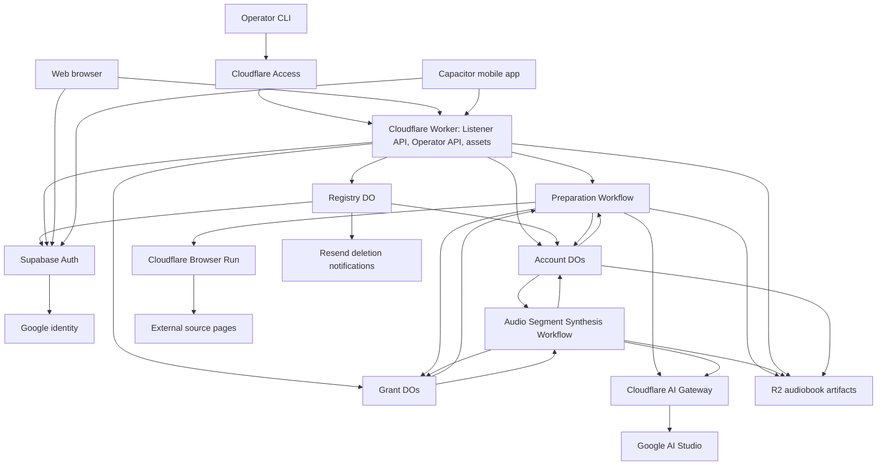
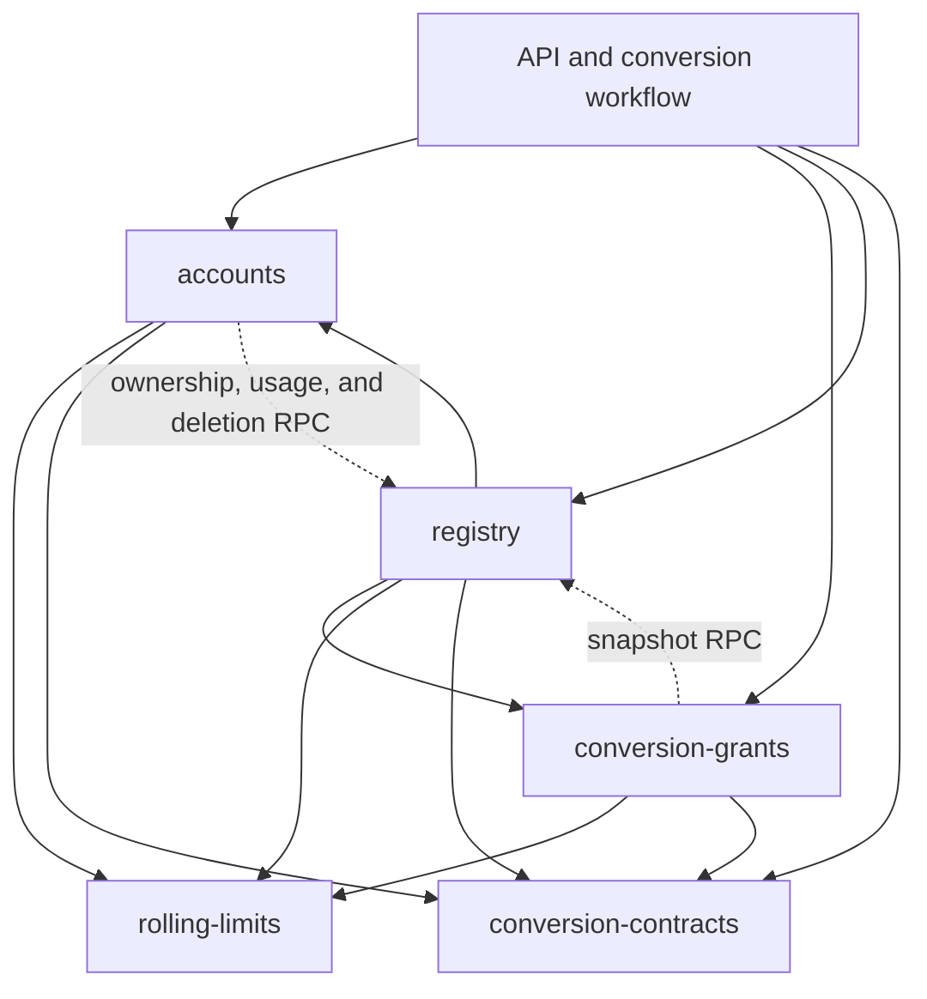

# System overview

Cup turns source content behind a URL into an audiobook. A shared web application runs in a browser and in Capacitor mobile shells. A Cloudflare Worker serves the web assets and APIs, while Cloudflare Workflows coordinates conversion and SQLite Durable Objects own mutable application state.

## Runtime map

The Worker is the HTTP boundary. Separate preparation and audio segment synthesis workflows perform durable conversion work inside the same Worker; account and trial objects control ownership, allowance, and lifecycle. The shared registry also coordinates cleanup across R2 and Supabase and sends lifecycle notifications. The diagram groups resources by responsibility; a Durable Object class creates multiple isolated objects where required.

## Responsibilities and code boundaries

| Component                                 | Responsibility                                                                                 | Implementation                                                                                                                      |
| ----------------------------------------- | ---------------------------------------------------------------------------------------------- | ----------------------------------------------------------------------------------------------------------------------------------- |
| Web application                           | Conversion entry, account UI, playback, and session management                                 | [Web source](../../apps/web-app/)                                                                                                   |
| Native shells                             | Package the shared UI and supply platform sign-in, sharing, links, and media integration       | [Mobile guide](../../apps/mobile-app/README.md), [platform adapters source](../../apps/web-app/src/platform/)                       |
| Operator CLI                              | Administrative requests authenticated through Cloudflare Access                                | [Operator guide](../../apps/operator/README.md)                                                                                     |
| Worker and API server                     | Assets, domain routing, authentication, request validation, conversion admission, and delivery | [Worker entry source](../../apps/cloudflare-worker/src/index.ts), [API composition source](../../libs/api-server/src/api-server.ts) |
| Preparation Workflow                      | Source rendering, narration selection, document storage, and preparation outcomes              | [Preparation entry point](../../libs/create-audiobook-from-url-workflow/src/prepare-audiobook-workflow.ts)                          |
| Audio segment synthesis Workflow          | One segment's speech generation, artifact storage, and duration settlement                     | [Synthesis entry point](../../libs/create-audiobook-from-url-workflow/src/synthesize-audio-segment-workflow.ts)                     |
| Account and trial state                   | Ownership, history, duration accounting, synthesis dispatch, and lifecycle                     | [Storage ownership](#storage-ownership)                                                                                             |
| Source preparation                        | Render source pages, prepare audiobook source material, and fetch declared cover images        | [Preparation library](../../libs/prepare-source-material/)                                                                          |
| Narration selection and document creation | Select source material and structure narration text and synchronization units                  | [Selection library](../../libs/narration-content-selection/), [document creation library](../../libs/narration-document-creation/)  |
| Audiobook production                      | Store prepared narration and synthesize independently playable audio segments                  | [Audiobook production library](../../libs/audiobook-production/)                                                                    |

The libraries are code boundaries inside the deployed system, not separate network services. [Accounts](../../libs/accounts/README.md) owns account conversion state, duration accounting, lifecycle transitions, and artifact fencing. [Conversion grants](../../libs/conversion-grants/README.md) owns trial grants. [Registry](../../libs/registry/README.md) owns account identity mapping and provisioning, grant inventory, conversion ownership for both accounts and trials, ingress limits, and account deletion coordination. Owner objects consume narrow registry RPC interfaces; integration tests in the registry library exercise the three objects together. [Conversion contracts](../../libs/conversion-contracts/README.md) owns runtime-independent shared schemas, types, and duration calculations. [Rolling limits](../../libs/rolling-limits/README.md) provides the rolling-window rate limiter and its `rate_events` table, which the account, grant, and registry objects each keep in their own databases. [Errors](../../libs/errors/README.md) holds the root-cause helpers that every server log of a caught error goes through, so wrapper errors carrying SQL parameters or request data are never logged, and `assertUnreachable` for exhaustive branches over unions. It is a separate library rather than part of conversion contracts because it holds no conversion concept, and it imports no Cup package, so any library can depend on it without a cycle.

## API definitions

The listener API serves the web and mobile apps that listeners use; the operator API serves the operator CLI. The [listener contracts](../../libs/listener-api.routes/src/hono-app.ts) and [operator contracts](../../libs/operator-api.routes/src/hono-app.ts) define HTTP methods, paths, and schemas. Operator account responses compose the [account contracts](../../libs/accounts/src/account-contracts.ts) for what the account Durable Object returns, so the account owns those shapes and the operator API keeps no copies. The account inspection and account deletion list handlers check the responses they build against the operator response types at compile time rather than parsing them at runtime, so a shape the contract does not describe is returned as the Durable Object reported it instead of failing as a server error; the [route tests](../../libs/api-server/test/operator-access.test.ts) parse these responses strictly. Listener handlers also type their responses with `satisfies` instead of parsing them, and they copy only the declared fields from Durable Object results through the [listener response mappings](../../libs/api-server/src/http/listener-responses.ts), so internal fields such as an account outcome's storage reference and failure category never reach listeners. The listener history item picks its fields from the account contracts, and the listener account snapshot rebuilds the account snapshot from them. Because listener response schemas are tolerant, the [listener route tests](../../libs/api-server/test/listener-responses.test.ts) parse every successful listener JSON response with a strict variant derived from the contract schema. Requests are still parsed against their schemas at runtime. [Server composition](../../libs/api-server/src/api-server.ts) mounts their handlers. Account deletion and recovery handlers are implemented directly in the server composition. Each contract package generates its API's OpenAPI document and checks it against a committed snapshot, so contract changes show in diffs; see the [listener contracts guide](../../libs/listener-api.routes/README.md) and the [operator contracts guide](../../libs/operator-api.routes/README.md). The [OpenAPI export](../../libs/listener-api.client/scripts/export-openapi-json.ts) writes the listener document to the listener client's build output; the operator document is not exported. Each contract's error envelope carries an error code from the contract's `ERROR_CODE`, a message, and the request ID. The [listener client](../../libs/listener-api.client/src/rpc-error.ts) and [operator client](../../libs/operator-api.client/src/rpc-error.ts) each export their own `ERROR_CODE` copy, checked against the contract's error code type at compile time while importing only types from the contract package, and share [response handling](../../libs/api-rpc.client/src/rpc-response.ts): every unsuccessful response rejects with the client's `RpcError`, carrying the API error code, HTTP status, retry delay, and the server's request ID. A response without an error code the client knows, such as a proxy error page, gets `operational-error`. Callers compare `code` with the client's `ERROR_CODE` rather than with string literals. [ADR 0010](../adr/0010-tolerate-unknown-keys-at-the-listener-api.md) sets how strictly contracts validate requests and responses: listener request and response schemas drop unknown keys, while operator API requests and internal inputs stay strict. When a strict shared schema also appears in a listener request or response, the [listener contracts](../../libs/listener-api.routes/src/contracts.ts) rebuild it from the same shape without `.strict()`. This applies to playback positions, duration balances, synchronization units, grant snapshots, and account snapshots. The trial conversion snapshot in the [grant contracts](../../libs/conversion-grants/src/domain/grant-contracts.ts) only describes listener responses, so it is tolerant where it is defined. See [authentication and authorization](authentication.md) for access rules. Durable Object RPC and Workflow invocation are internal platform interfaces.

## Storage ownership

Each Durable Object has its own SQLite database; account and grant objects isolate state by owner. See the [database schema diagrams](durable-object-storage.md) for tables, columns, keys, and declared relationships in all three stores. Drizzle schemas define the tables, constraints, and indexes for all three stores, and application queries use the Drizzle Durable Object driver. Each object applies its generated migrations before accepting work; database changes follow the [account migration guide](../../libs/accounts/README.md#database-migrations), the [grant migration guide](../../libs/conversion-grants/README.md), or the [registry migration guide](../../libs/registry/README.md). `RegistryDurableObject` reuses the deployed grant registry namespace through a Cloudflare class rename; the account registry was never deployed. The existing singleton name remains `registry`.

The one-time transition from handwritten trial schemas preserves grant identities, credentials, settings, and registry inventory while discarding old conversions and restoring full configured allowances. Old audiobook ownership routes are removed, so those links stop resolving; R2 artifacts are retained separately. New conversions survive subsequent migration replays. [ADR 0004](../adr/0004-preserve-only-grants-during-drizzle-transition.md) defines this exception to historical retention.

| Store                   | Ownership and purpose                                                                                                                          | Primary source                                                                                     |
| ----------------------- | ---------------------------------------------------------------------------------------------------------------------------------------------- | -------------------------------------------------------------------------------------------------- |
| Account object          | One per account; private conversion history, duration ledger, and lifecycle state                                                              | [Account object](../../libs/accounts/src/account-durable-object.ts)                                |
| Conversion grant object | One per trial grant; shared allowance and duration ledger, credentials, sessions, and conversions                                              | [Grant object](../../libs/conversion-grants/src/durable-object/conversion-grant-durable-object.ts) |
| Registry                | Singleton identity-to-account mapping, grant inventory, owner usage projections, conversion ownership, provisioning, and deletion coordination | [Registry](../../libs/registry/src/durable-object/registry-durable-object.ts)                      |
| Supabase Auth           | Identity-provider data; Cup application state remains in Durable Objects                                                                       | [Auth configuration](../../supabase/config.toml)                                                   |
| R2 audiobook bucket     | Conversion artifacts: prepared manifests, audio segments, and unit failure details                                                             | [Artifact storage](../../libs/audiobook-production/src/audio-segment-storage.ts)                   |

Cloudflare Workflows owns execution state; the account or grant object owns the application-visible conversion outcome. See [R2 objects and key layout](r2-storage.md) for prefixes, object contents, and metadata, [conversion](conversion.md) for artifact production and delivery, and [account deletion](account-deletion.md) for cleanup and write fencing. Infrastructure state is covered by the [Terraform guide](../../terraform/README.md).

## External services

- Cloudflare Access: protects operator requests
- Cloudflare Browser Run: visits external source pages and fetches the cover images they declare
- Cloudflare AI Gateway: routes provider requests and records request metadata
- Google AI Studio: narration services (TTS provider)
- Supabase Auth: IAM (Cup owns account authorization and application data)
- Google Auth Platform: social sign-in
- Resend: account-deletion emails

## Development and test view

Local web development uses Wrangler and can use a local Supabase stack through `pnpm dev:services`. Native Android uses the production API origin; starting local Supabase does not redirect the native app. See [local development](../local-development.md) for environment setup.

Tests use [account test bindings](../../libs/accounts/wrangler.test.jsonc), [grant test bindings](../../libs/conversion-grants/wrangler.test.jsonc), [Worker integration test bindings](../../apps/cloudflare-worker/test/wrangler.test.jsonc), [application E2E bindings](../../qa/e2e/wrangler.jsonc), and [source-page fixtures](../../libs/prepare-source-material/test-e2e/fixtures/README.md). The [Worker integration tests](../../apps/cloudflare-worker/AGENTS.md#integration-tests) run the production Worker entry with fresh local storage per test and without the Workers AI and Browser Rendering bindings, with provider URLs, Resend's included, pointed at an unreachable local address, so they reach no paid or external service; they also check that the integration test bindings match the production Worker configuration. Browser tests run through Docker. Fixtures and local-development authentication paths are test infrastructure, not production identity providers. The [validation guide](../../AGENTS.md#validation) distinguishes free checks from paid narration evals.
