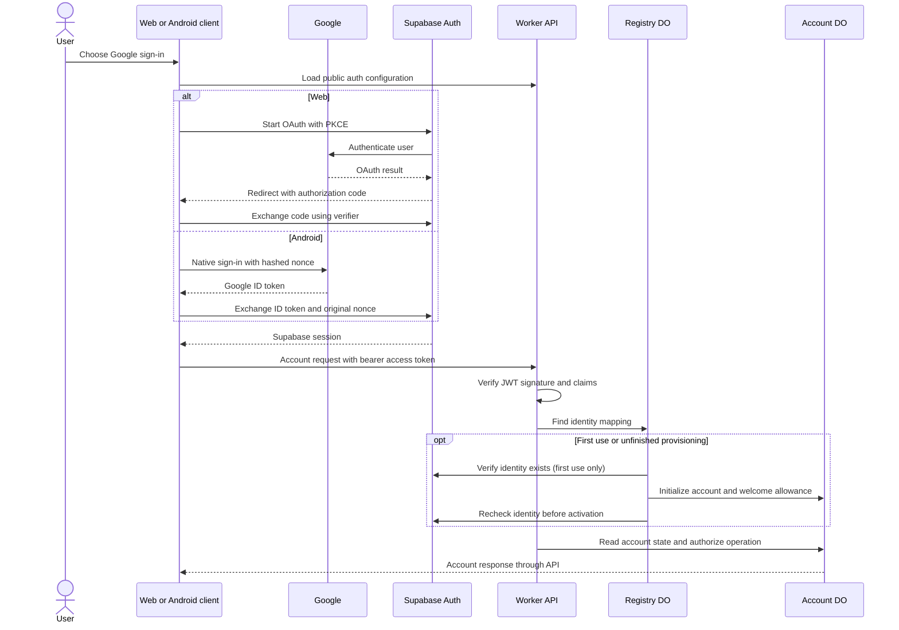
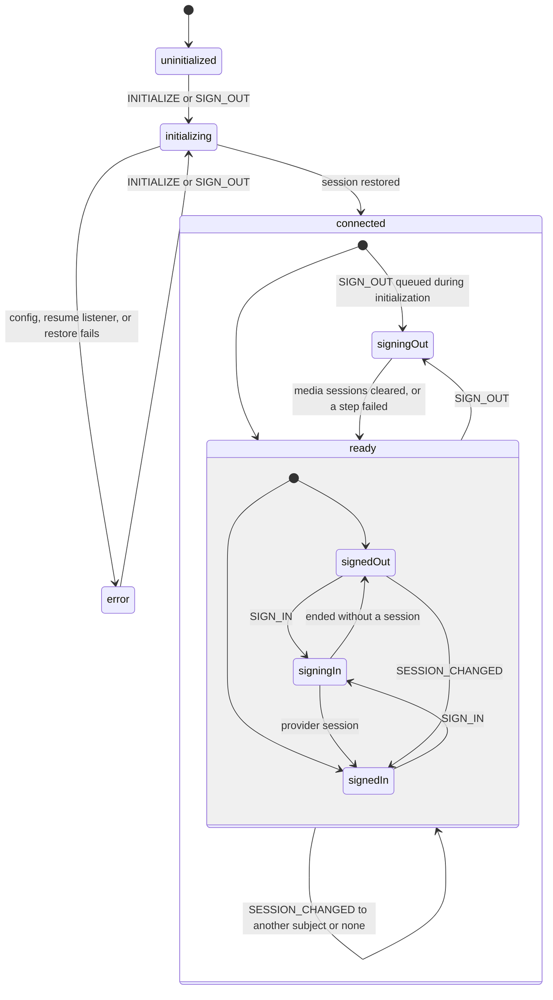
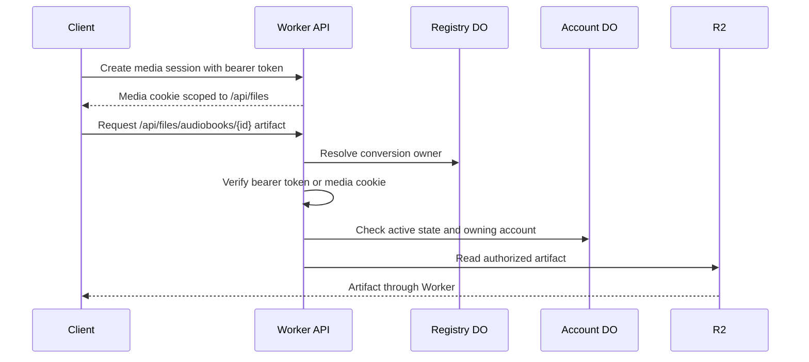

# Authentication and authorization

Supabase establishes identity; Cup decides whether that identity may access a particular account or conversion. A valid access token does not override an account's deletion state or establish ownership of an audiobook.

## Sign-in and account provisioning

On the web, the Supabase SDK persists the session and PKCE verifier in browser local storage and handles the OAuth return. Android uses native Google sign-in bound to a nonce, exchanges its ID token with Supabase, and persists the Supabase session in secure storage. Dedicated iOS account support is deferred; its adapter reuses web behavior and is not evidence of a validated native login flow.

The API verifies Supabase JWTs locally against the issuer's signing keys and their claims; the [account authentication use case](../../libs/api-server/src/use-cases/authenticate-account.ts) then resolves the Cup account. First use provisions a separate Cup account ID through the registry. Provisioning is persisted and retried, and checks the provider identity before activation; ingress limits constrain new account creation. The account initializes its welcome duration allowance once. Subsequent operations consult Cup lifecycle state in addition to token validity.

The web client sends every API request through one [request module](../../apps/web-app/src/data-fetching/api-request.ts), where each call states whether it sends no account token, the signed-in account's token if there is one, or requires a signed-in account. Account operations name the account they were issued for and are refused once a different account is signed in. Grant sessions travel as cookies regardless of this choice.

Sources: [web adapter](../../apps/web-app/src/platform/account-auth.web.ts), [Android adapter](../../apps/web-app/src/platform/account-auth.android.ts), [iOS adapter](../../apps/web-app/src/platform/account-auth.ios.ts), [token verification](../../libs/api-server/src/http/account-auth.ts), and [registry provisioning](../../libs/registry/src/durable-object/registry-durable-object.ts).

## Client session lifecycle

The web client models account auth as an [XState machine](../../apps/web-app/src/auth/account-session-machine.ts), following [ADR 0009](../adr/0009-use-xstate-for-client-lifecycle-state-machines.md). A [facade](../../apps/web-app/src/auth/account-session.ts) keeps the promise-based functions that routes, data fetching, and the player call, and derives the loading, signed-out, signed-in, or error state the UI shows.

Initialization loads the public auth configuration, creates the Supabase client, registers the native app-resume listener, and restores the stored session. When the app resumes with an account signed in, the media cookie is issued again; if that fails, playback stops. Every change of the signed-in subject stops playback, and signing into an account forgets the remembered trial. Replacing or removing a signed-in account also clears the query cache; the initial restoration does not, because route loaders may be awaiting it.

The machine's comments hold the transition rules. It guarantees:

- A session read that started in one session scope never resolves to a session of another account: starting a sign-in, starting a sign-out, or replacing the signed-in subject ends the scope, and an unfinished read resolves to no session.
- Only one OAuth flow runs at a time, because concurrent flows would overwrite each other's PKCE code verifier. A sign-in interrupted by a sign-out or an account switch still settles with the provider's outcome, because the provider call cannot be recalled.
- Media cookie issuance is serialized across scopes, and sign-out waits for an issuance in flight before clearing the web and native media sessions, so a late response cannot reestablish playback.
- Sign-out stops and unloads audio, signs out of Supabase locally, and clears the stored session and the remembered trial. If Supabase could not confirm server revocation, sign-out still completes locally and reports the failure. If initialization failed, the UI shows the auth error because the stored session could not be cleared.
- When account auth cannot initialize and no account is signed in, requests that accept either authorization, such as trial pages and audiobook reads, continue with the grant session alone.

## Resuming a conversion after sign-in

When a reader submits a source URL for an account conversion, the client saves one pending request, with the normalized source URL and an idempotency key, in `sessionStorage` before either starting the conversion or asking the reader to sign in. On the web, this preserves the reader's submission through the Google/Supabase redirect and page reloads within the tab's session. The request stays out of the OAuth callback URL, and its lifetime is limited to the tab's session rather than persisting as a long-lived draft. This storage is separate from the Supabase session and PKCE verifier in local storage; it does not establish identity or authorize a conversion.

When a signed-in session becomes available, the client resumes a stored submitted request automatically. Submitting the same normalized URL reuses its idempotency key so retries can refer to the same server request; submitting a different URL replaces the pending request with a new key. Cancelling the sign-in prompt retains the URL and key but marks the request as unsubmitted, preventing automatic resumption.

Successful admission clears the matching pending request before navigating to the audiobook. A rate-limit response marks the matching request as unsubmitted, retaining its URL and key for an explicit retry. Other failures leave the request available for retry, including automatic resumption on a later mount when it is still marked submitted. Response handlers check the current account identity and request key before changing stored state, so a late response cannot clear or disable a newer request. These rules also apply to the shared submission code used by Android, whose native Google sign-in does not use the web callback.

Sources: [pending request storage](../../apps/web-app/src/data-fetching/account-conversion-storage.ts), [submission and resumption](../../apps/web-app/src/app/use-cases/account-conversions.ts), and [admission response handling](../../apps/web-app/src/data-fetching/account.ts).

## Private media access

Browser audio elements need an authorization path beyond ordinary JSON requests. The client obtains a media session using its bearer token, and the Worker issues an HTTP-only cookie for media delivery that expires no later than the token. Android also installs the session through its [native media bridge](../../apps/mobile-app/android/app/src/main/java/audio/cup/app/AccountMediaPlugin.java).

The [listener contracts](../../libs/listener-api.routes/src/hono-app.ts) define the routes. Audiobook JSON requires bearer identity for private audiobooks; audio segments and cover images under `/api/files` accept bearer identity or the cookie. Native players send the bearer token directly. Media-session creation and account API operations require bearer identity. Private delivery checks the conversion's owner and current account state on requests. Scheduling deletion therefore blocks subsequent private requests even while a previously issued JWT remains unexpired. This is not a promise to retract bytes already downloaded by another client.

The web application's [`PlaybackSession`](../../apps/web-app/src/app/player/playback-session.ts), one per loaded audiobook, authorizes media only for the signed-in user the audiobook was loaded for and refuses another signed-in user. The client requests the media cookie when the audiobook loads, again on every Play, so access revoked while paused is noticed promptly, and again before the browser preloads each following segment. Requests made while one is in flight share it. A settled cookie is never reused, because its lifetime is computed on the Worker's clock, which the client cannot compare with its own. A cookie the Worker refuses stops playback; a request that fails otherwise is reported, and after Play it also pauses playback. Native players send the bearer token themselves on load and on every Play, without waiting for the cookie, which on native platforms serves only WebView requests such as cover images. Anonymous and trial listeners need no media cookie, because the grant cookie or public access covers their media. Sign-out waits for outstanding cookie issuance before clearing media sessions, as described under [client session lifecycle](#client-session-lifecycle). Local sign-out is not an immediate global revocation mechanism for every existing JWT.

Sources: [media cookie and token handling](../../libs/api-server/src/http/account-auth.ts), [ownership middleware](../../libs/api-server/src/api-server.ts), [delivery](../../libs/api-server/src/http/serve-audiobook.ts), [media cookie requests](../../apps/web-app/src/app/player/player-host.ts), and [client session transitions](../../apps/web-app/src/auth/account-session-machine.ts).

## Trial access

A trial link carries a grant credential that is exchanged for a grant session. That session authorizes inspecting the grant and starting conversions while the grant permits it; it does not establish a personal account or authorize listing all grant conversions. Reading prepared trial text and replaying completed audio require a valid session for the owning grant. The Worker checks the authoritative grant state before loading artifacts on every audiobook and media request, including HEAD, range, and conditional requests. Expired or revoked grants deny access; exhausted or fully reserved allowances still permit reading and replay. An article link alone, another grant’s session, or account sign-in alone does not authorize access. Retrying preparation or synthesis requires a session for the owning grant. Preparation can proceed with exhausted duration; synthesis requires reservations covering the whole document. Trial media uses the HTTP-only [grant cookie](../../libs/conversion-grants/src/domain/grant-session.ts); browser audio requests send credentials, and native players forward the grant cookie. Credentialed CORS permits only the configured application origins, and API responses default to `private, no-store`. Expiry and revocation block subsequent requests but cannot retract already downloaded text or audio. The API answers a missing or invalid grant session with 401: the grant and conversion routes distinguish `grant-session-required` from `grant-session-invalid` and clear an invalid cookie, while audiobook, media, and retry requests answer both with `grant-session-required`. The trial page then asks the reader to open the original trial link again, distinct from a revoked or invalid trial link. [ADR 0007](../adr/0007-require-active-grant-access-for-trial-audiobooks.md) records this access policy.

Listening positions belong to the signed-in listener, including positions on trial articles authorized by their owning grant. Anonymous listeners keep positions locally on their browser or native device. Account history contains conversions started by that account, and the client clears its remembered trial when switching into an account.

Sources: [grant-session handlers](../../libs/api-server/src/api-server.ts), [grant object](../../libs/conversion-grants/src/durable-object/conversion-grant-durable-object.ts), [client conversion-grant flow](../../apps/web-app/src/data-fetching/conversion-grant.ts) and its [error handling](../../apps/web-app/src/routes/trials.$grantId.tsx), and [client audiobook reads](../../apps/web-app/src/data-fetching/reader.ts).

## Operator access and lifecycle confirmation

The operator CLI authenticates through Cloudflare Access. The Worker validates the Access assertion against its configured issuer, audience, and operator identity before admitting operator routes. Development token handling is restricted to trusted development URLs. Operator authentication is separate from customer Google/Supabase sign-in. Operators can list accounts from the registry's identity mapping and record signed, idempotent allowance adjustments in an active account's ledger; neither action authenticates as, or changes the sign-in identity of, the account.

Deletion and recovery additionally require a one-use challenge, fresh Google authentication, and request origin and content-type checks; see [account deletion](account-deletion.md#confirmation-and-recovery).

Sources: [operator guide](../../apps/operator/README.md), [Access verification, routing, and lifecycle handlers](../../libs/api-server/src/api-server.ts), and [development access](../../libs/api-server/src/http/operator-access.ts). Provider configuration and outstanding rollout verification belong in [production configuration](../production-configuration.md) and the [Terraform guide](../../terraform/README.md).

## Historical evidence and deferred work

The [auth service comparison](../research/social-signup/auth-saas-research.md) and [native sign-in investigation](../research/social-signup/native-social-sso-research.md) preserve the provider evaluation. The [session-revocation investigation](../research/social-signup/supabase-session-revocation-research.md) describes an online validation alternative; this checkout uses local JWT verification instead. The [Apple/iOS handoff](../research/social-signup/deferred-apple-ios.md) records deferred integration questions, not a validated flow or launch commitment.
