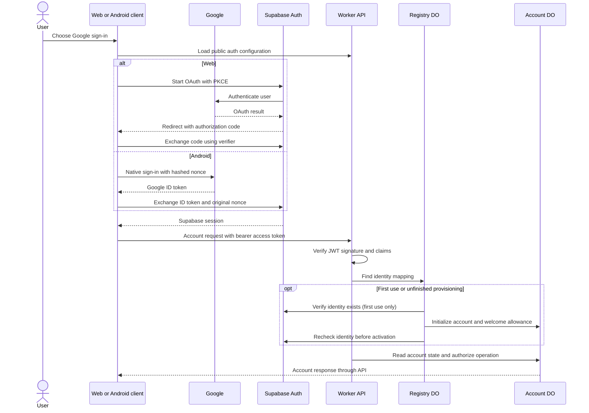
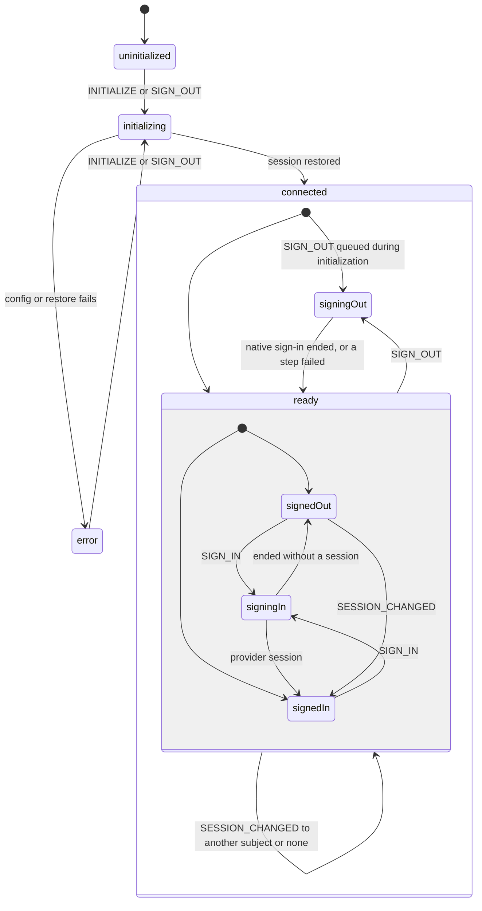
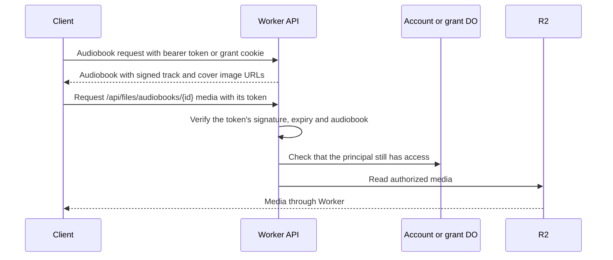

# Authentication and authorization

Supabase establishes identity; Cup decides whether that identity may access a particular account or conversion. A valid access token does not override an account's deletion state or establish ownership of an audiobook.

## Sign-in and account provisioning

[Open this diagram in Mermaid Live](https://mermaid.live/view#pako:eJyFVNtu2zAM_RVCTxvQ_IAfAgS9DNmGNUi3FRjywsiMTVQRPYlKb9i_D7JiJ20yzE-6HB0eHpJ-NVZqMpWJ9DuRt3TF2ATcrjwAAFqVAD8ihbLvMChb7tArXDomr4AR7mkNEmDm6yBcg-0vTh98EmkcnZ7PkraZ5i51uMZI_cEZ2GLeB5PwQCHvTiFLajhqeM64cX11e4bLWklF_LAcYDnZyXRasqvgshWJtNcOkRs_YV-QBTKZTmeLeQVfBWvo0tqxBcwZWfEbblJAZdm_QKfZrLJ5S5G0reBOMSjc9oY8sraw-HJ5fUDn88l0WrRU_Za8skUlSGON8lcgk5G4UAaKyek7vqNcl1RzIKsldk5CAr_0-iF3yT91Xz_ZFn1DPQpSZN_AjgJveBBFLte1NMgZmiGlb6i8G20uOlqMLdXgxVs6l-Ggfl-i-RWoPJD_v9gBCehrkMANe3THccjvtb43auzUSDGO1X3bD0NfhTxXce_pmjBQALSWYjzWOVvMh4c_s3HP8Pn-e-8DagrUS7QOeRuP8UOPV3DDvgauczvoM2yx69g3BSqdwg2HqLlH8pwmv2HPvaldkB3nDEZ0_gba0bK9pJGfnjhqhA-bA613zx_PMxQfKph7VkbHL5TzL-Pna3gkZ2VLgM7JI76p8YmOJdmW7MNByJo2kt2xyrujOTsUrtg6SFgS1mPwqHlusoSh0wmko-N53T88Lv2hrLETHwm0DZKaNocyF2ZLYYtcm8q8ZoqV0Za2tDIVrEygOj1NrDgJK7Pyf8yFSV2NOvxyTaUh0YVpQiYo6w79L5Hxqg9lqg26SH_-AgwM67o)

On the web, the Supabase SDK persists the session and PKCE verifier in browser local storage and handles the OAuth return. Android uses native Google sign-in bound to a nonce, exchanges its ID token with Supabase, and persists the Supabase session in secure storage. Dedicated iOS account support is deferred; its adapter reuses web behavior and is not evidence of a validated native login flow.

The API verifies Supabase JWTs locally against the issuer's signing keys and their claims, and admits only identities whose provider is Google, whatever providers the Supabase project enables ([`account-auth.test.ts`](../../libs/api-server/test/account-auth.test.ts)); the [account authentication use case](../../libs/api-server/src/use-cases/authenticate-account.ts) then resolves the Cup account. First use provisions a separate Cup account ID through the registry. Provisioning is persisted and retried, and checks the provider identity before activation; ingress limits constrain new account creation. The account initializes its welcome duration allowance once; [`authenticate-account.test.ts`](../../libs/api-server/test/authenticate-account.test.ts) and the registry's [`accounts.test.ts`](../../libs/registry/test/accounts.test.ts) cover provisioning. Subsequent operations consult Cup lifecycle state in addition to token validity.

The web client sends its API requests through one [request module](../../apps/web-app/src/data-fetching/api-request.ts), where each call states whether it sends no account token, the signed-in account's token if there is one, or requires a signed-in account; a call for an account is refused once a different account is signed in ([`api-request.test.ts`](../../apps/web-app/src/data-fetching/api-request.test.ts)). Only the session machine's own plumbing, which loads the auth configuration, calls the API client directly; the [web app's lint configuration](../../apps/web-app/oxlint.config.ts) enforces both. Grant sessions travel as cookies regardless of this choice.

### Local test account

Local development offers one more sign-in, so that the web app can be tested, also from a phone, without a Google OAuth client ([ADR 0012](../adr/0012-offer-a-local-test-account-instead-of-google-in-development.md)). [`pnpm dev:services`](../local-development.md) creates an email and password identity in the local Supabase stack. Only while `LOCAL_DEVELOPMENT` is `"true"`, the Worker advertises its credentials in the public auth configuration and accepts its tokens; it refuses every other non-Google identity. The web client signs in with the password and shows the option only when the configuration offers it, and omits Google when the configuration names no Google client. Provisioning, ownership, and lifecycle checks treat the test account like any other account.

Sources: [web adapter](../../apps/web-app/src/platform/account-auth.web.ts), [Android adapter](../../apps/web-app/src/platform/account-auth.android.ts), [iOS adapter](../../apps/web-app/src/platform/account-auth.ios.ts), [token verification](../../libs/api-server/src/http/account-auth.ts), and [registry provisioning](../../libs/registry/src/durable-object/registry-durable-object.ts).

## Client session lifecycle

The web client models account auth as an [XState machine](../../apps/web-app/src/auth/account-session-machine.ts), following [ADR 0009](../adr/0009-use-xstate-for-client-lifecycle-state-machines.md). A [facade](../../apps/web-app/src/auth/account-session.ts) keeps the promise-based functions that routes, data fetching, and the player call, and derives the loading, signed-out, signed-in, or error state the UI shows.

[Open this diagram in Mermaid Live](https://mermaid.live/view#pako:eJylU8tu2zAQ_JUFj4V16ZGHAEFjpAQC-eD0kioIWHEtb2Hvuny4j8D_HoiMJTlx2gK5UTszO_vSo2rFodIqRBvximzn7bbaf2wYAODrh3uoqgtITEyR7Ib-oCvQSSiThm_iToOpza25vDF3cxAPS3NdPyy-3BbtlJml6L14Da3wirqe7zFE8QgrS5tQRJnzXqNWmLGN6DQEDIGEj1bPbeUxjDR4LOHpMDxa9_t1OFDHxN0iRT1UAT8SJnTgku8rGMqxkYTHFMU0550avsyObpHi32DDp-ggmhZo-Lk-U59jG_5vcsZP7DXsvOzJoT-O99-qPDBkhw5-UlxLimDfVp-2UzyX8-XSLOqHT58v6-v51Sg6jM8y3GF9r0QQBSxLXPelp2_fsY39ObEwnktybtmTfQ7o1JFtpD1msCIuLc96Ewsh4i7f-vEMD2qmtui3lpzSKt9Eo-Iat9goDY3y6NKvqpWN-EY13NPTzo1_sNLRJ5ypzvcJyntn-U5kgLykbq30ym4CHp4AyPdA6Q)

Initialization loads the public auth configuration, creates the Supabase client, and restores the stored session. Every change of the signed-in subject stops playback, and signing into an account forgets the remembered trial. Replacing or removing a signed-in account also clears the query cache; the initial restoration does not, because route loaders may be awaiting it.

The machine's comments hold the transition rules. It guarantees the following; [`account-session.test.ts`](../../apps/web-app/src/auth/account-session.test.ts) checks the session-scope and sign-out rules:

- A session read never resolves to another account's session: starting a sign-in or sign-out, or replacing the signed-in subject, ends the read's scope.
- Only one OAuth flow runs at a time, because concurrent flows would overwrite each other's PKCE code verifier. A sign-in interrupted by a sign-out still settles with the provider's outcome, because the provider call cannot be recalled.
- Sign-out stops and unloads audio, signs out of Supabase locally, clears the stored session and the remembered trial, and ends the platform's own Google sign-in on Android. It completes locally even when Supabase could not confirm server revocation, and reports the failure; if initialization failed, the UI shows the auth error because the stored session could not be cleared.
- When account auth cannot initialize and no account is signed in, requests that accept either authorization continue with the grant session alone.

## Resuming a conversion after sign-in

When a reader submits a source URL for an account conversion on the home page, the client saves one pending request, the normalized source URL and an idempotency key, in `sessionStorage` before starting the conversion or asking the reader to sign in. This carries the submission through the OAuth redirect and reloads without putting it in the callback URL or keeping a long-lived draft; it is separate from the Supabase session and establishes neither identity nor authorization.

Once a signed-in session is available, the client resumes a stored submitted request automatically, reusing its idempotency key so retries refer to the same server request; the [submission use case](../../apps/web-app/src/app/use-cases/account-conversions.ts) holds which outcomes clear, keep or resubmit it. Response handlers check the current account and request key before changing stored state, so a late response cannot clear or disable a newer request ([`account-conversions.test.ts`](../../apps/web-app/src/data-fetching/account-conversions.test.ts)). Android's native sign-in shares this submission code. A signed-in visit to the home page redirects to Recents unless such a request is stored, so a submission resumed after OAuth, or waiting out a rate limit, finishes on the home page and opens the reader.

Only the home page stores this request. The Add dialog keeps its request, with the same reuse of the idempotency key, only while it is open, so its starts never prefill or resume the home form or a later dialog, and never stop the home page's redirect.

Sources: [pending request storage](../../apps/web-app/src/data-fetching/account-conversion-storage.ts), [submission and resumption](../../apps/web-app/src/app/use-cases/account-conversions.ts), and [admission response handling](../../apps/web-app/src/data-fetching/account.ts).

## Private media access

Browser audio and image elements cannot send an `Authorization` header, so media under `/api/files` is authorized by a signed media URL instead. The audiobook response carries one for the narration track and one for the cover image, and a ready history item with a cover carries one for its cover image, each issued to the principal the response was authorized for; the client plays and shows them as they are.

[Open this diagram in Mermaid Live](https://mermaid.live/view#pako:eJxtkk1rIzEMhv-K8GUvCYEc5xAY2kugS8PA7kKZi2orYzEz9qys6ceG_PfF47QNpDdbevXoleyTsdGRqUyivzMFS_eMneDYBgCACUXZ8oRB4W5gCnobrw97wAR_ovQk-XYreXwNJFlUWxvnoBAFOsmZ-8dbdbMtsdJwvdvVh30F9ew4PsfYg2SnSeGV1cMzoZCAxp7CF9bG2DMVTH3Yr9e7XaFdc5b6xF0gBypoe8DgwMYXEuARO4JfzUP6zktzcbDBiTdHHiht8AObNid2ZxjJMZYWrKn4-_Jz4fwm4eM7qKci-JEWP6iz0ArobWJ5X0x90q8Ry1YruPNke1CPuoAm4ZAXOUBSHgbwmACtpZSua5ttngIzWX0U_keuWC6iZnu9sp_LLOolzp2_PLRZmZFkRHamMqdc1Rr1NFJrKmiNkJvf1jYOUVrThrNZmXlyqB_fy1QqM61MJxlQzhOGpxg_U0s3Ux1xSHT-DyTo5u8)

The [listener contracts](../../libs/listener-api.routes/src/hono-app.ts) define the routes. Audiobook JSON requires bearer identity for private audiobooks and the owning grant session for trial audiobooks. Media routes accept only a signed media URL: a bearer token, the grant cookie or any other cookie alone answers `401`. Account API operations require bearer identity. Private delivery checks the conversion's owner and current account state on every request ([`private-account-access.test.ts`](../../libs/api-server/test/private-account-access.test.ts)), so scheduling deletion blocks subsequent private requests even while a previously issued JWT remains unexpired. This is not a promise to retract bytes already downloaded by another client.

The web player loads the narration track for the signed-in user the audiobook was loaded for, and a change of that user unloads it ([`player-host.test.ts`](../../apps/web-app/src/app/player/player-host.test.ts)). Local sign-out is not a global revocation of existing JWTs.

### Signed media URL

A signed media URL authorizes media requests by its `token` query parameter alone. The token is stateless: an HMAC with the `MEDIA_URL_SIGNING_KEY` Worker secret over the audiobook (conversion) ID, the principal, and an expiry. The principal is the account for a signed-in request and the grant for a trial request. Its issue time is the start of the current UTC day and it expires 48 hours after that ([ADR 0013](../adr/0013-cache-cover-images-in-the-browser-for-a-day.md)): within one UTC day, every response hands out a byte-identical URL for the same audiobook, resource and principal, and every URL stays valid for at least 24 hours after it is handed out. Nothing is stored, so a token cannot be revoked individually; rotating the secret invalidates every outstanding URL.

On every request, including HEAD, range and conditional requests, the Worker first checks the token's signature, expiry and audiobook ID against the route's `{conversionId}`; a missing, malformed, expired or foreign token answers `401` with `media-url-invalid`. It then runs the authoritative checks of the principal's own credentials: an active account that owns the conversion, or an unexpired, unrevoked grant that owns it. Scheduling account deletion and expiring or revoking a grant therefore block the next request, as [ADR 0007](../adr/0007-require-active-grant-access-for-trial-audiobooks.md) requires, and such denials answer as the equivalent audiobook request does. Successful cover responses may be cached privately for a day, so a browser shows a cover it loaded earlier that UTC day without asking the Worker; cover errors, the narration track and every other response are not cached ([delivery](../../libs/api-server/src/http/serve-audiobook.ts)). A cover can therefore stay in a device's browser cache for up to a day after access ends, though the UI cannot show it, because cover URLs come only from access-checked audiobook and history responses. The URL is a bearer credential for its lifetime: local sign-out does not invalidate a URL already issued, and anyone holding it can fetch that audiobook's media while the principal keeps access. [`signed-media-url.test.ts`](../../libs/api-server/test/signed-media-url.test.ts) and [`narration-track.test.ts`](../../libs/api-server/test/narration-track.test.ts) cover these rules.

The web player renews the narration track URL on an in-app Play, so a listening session outlives the token: when the URL the client received, dated by when its audiobook response arrived however long it then sat in the [query cache](web-app.md#query-cache), is older than the [player host](../../apps/web-app/src/app/player/player-host.ts)'s renewal age, half the 24 hours the server guarantees so a skewed client clock still renews in time, or when the previous playback ended in a media error, as an expired token does, Play requests the audiobook again and resumes at the same position. Nothing renews while the device is locked, because the lock screen and notification controls drive the element directly: a lock-screen Play after the token expired fails until the listener opens the app and presses Play. [`player-host.test.ts`](../../apps/web-app/src/app/player/player-host.test.ts) covers renewal with a fake clock.

Sources: [token signing, verification and media authorization](../../libs/api-server/src/http/signed-media-url.ts), [ownership middleware](../../libs/api-server/src/api-server.ts), [delivery](../../libs/api-server/src/http/serve-audiobook.ts), and [client session transitions](../../apps/web-app/src/auth/account-session-machine.ts).

## Trial access

A trial link carries a grant credential that is exchanged for a grant session. That session authorizes inspecting the grant and starting conversions while the grant permits it; it does not establish a personal account or authorize listing all grant conversions. Reading prepared trial text requires a valid session for the owning grant, checked against the authoritative grant state before any artifact is loaded; replaying audio requires a [signed media URL](#signed-media-url) issued to the owning grant, checked against the same state on every request. Expired or revoked grants deny access; exhausted or fully reserved allowances still permit reading and replay. The audiobook's link alone, another grant's session, or account sign-in alone does not authorize access. [ADR 0007](../adr/0007-require-active-grant-access-for-trial-audiobooks.md) records this policy and [`trial-audiobook-access.test.ts`](../../libs/api-server/test/trial-audiobook-access.test.ts) enforces it, including that credentialed CORS admits only the configured application origins and that responses default to `private, no-store`.

Retrying preparation or synthesis also requires a session for the owning grant; preparation can proceed with exhausted duration, synthesis requires reservations covering the whole document. The HTTP-only [grant cookie](../../libs/conversion-grants/src/domain/grant-session.ts) authorizes JSON grant requests only; media routes do not accept it. Expiry and revocation cannot retract already downloaded text or audio. A missing or invalid grant session gets 401, with the error codes the [listener contracts](../../libs/listener-api.routes/src/contracts.ts) declare per route, and the trial page asks the reader to open the original trial link again.

Listening positions belong to the signed-in listener, including positions on trial audiobooks authorized by their owning grant. Anonymous listeners keep positions locally in their browser. Account history contains conversions started by that account, and the client clears its remembered trial when switching into an account.

Sources: [grant-session handlers](../../libs/api-server/src/api-server.ts), [grant object](../../libs/conversion-grants/src/durable-object/conversion-grant-durable-object.ts), [client conversion-grant flow](../../apps/web-app/src/data-fetching/conversion-grant.ts) and its [error handling](../../apps/web-app/src/routes/trials.$grantId.tsx), and [client audiobook reads](../../apps/web-app/src/data-fetching/reader.ts).

## Operator access and lifecycle confirmation

The operator CLI authenticates through Cloudflare Access. The Worker validates the Access assertion against its configured issuer, audience, and operator identity before admitting operator routes. Development token handling is restricted to trusted development URLs. Operator authentication is separate from customer Google/Supabase sign-in. Operators can list accounts from the registry's identity mapping and record signed, idempotent allowance adjustments in an active account's ledger; neither action authenticates as, or changes the sign-in identity of, the account.

Deletion and recovery additionally require a one-use challenge, fresh Google authentication, and request origin and content-type checks. Freshness counts only the sign-in method of the identity's own provider, so a new password sign-in confirms for the local test account, which never triggers Google token revocation; see [account deletion](account-deletion.md#confirmation-and-recovery).

Sources: [operator guide](../../apps/operator/README.md), [Access verification, routing, and lifecycle handlers](../../libs/api-server/src/api-server.ts), and [development access](../../libs/api-server/src/http/operator-access.ts). Provider configuration belongs in [production configuration](../production-configuration.md) and the [Terraform guide](../../terraform/README.md).

## Historical evidence and deferred work

The [auth service comparison](../research/social-signup/auth-saas-research.md) and [native sign-in investigation](../research/social-signup/native-social-sso-research.md) preserve the provider evaluation. The [session-revocation investigation](../research/social-signup/supabase-session-revocation-research.md) describes an online validation alternative; this checkout uses local JWT verification instead. The [Apple/iOS handoff](../research/social-signup/deferred-apple-ios.md) records deferred integration questions, not a validated flow or launch commitment.
