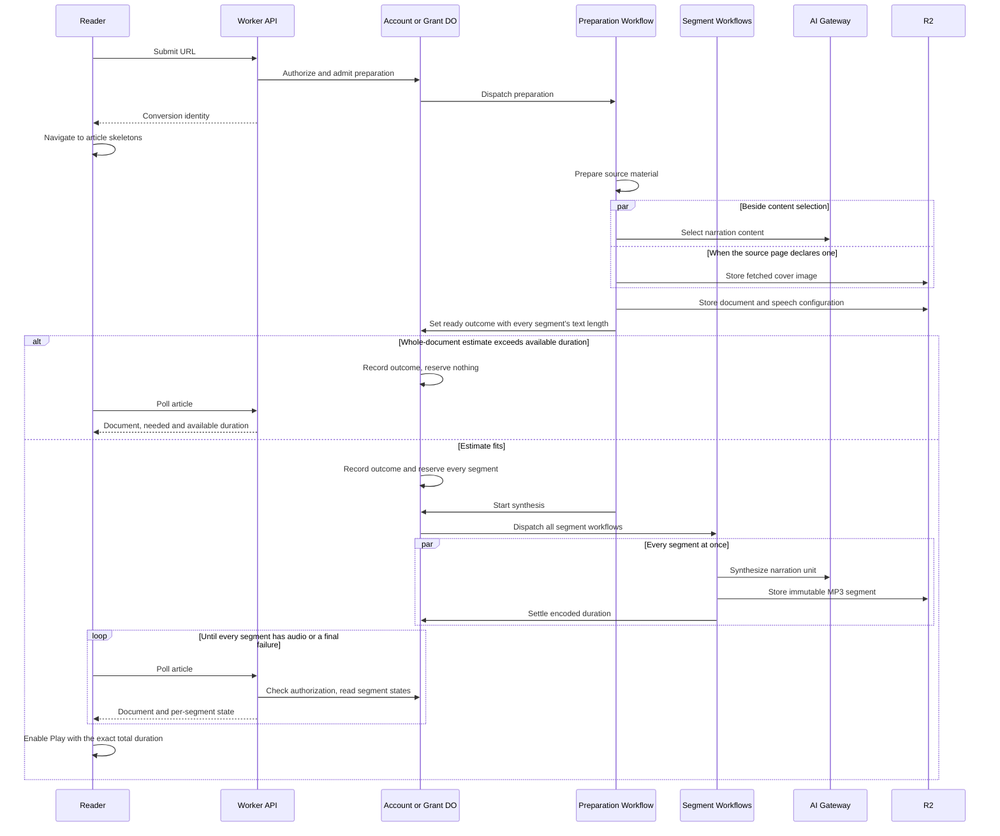
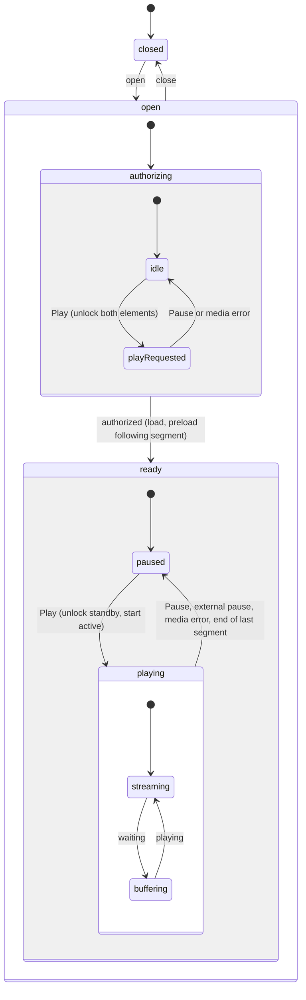

# Conversion from source URL to audiobook

The API admits preparation, an account or trial grant owns allowance and outcomes, and Cloudflare Workflows runs durable processing steps. R2 stores the prepared narration document and one independently stored audio segment per synchronization unit. [ADR 0008](../adr/0008-synthesize-the-whole-narration-document.md) records why the whole document is synthesized as part of the conversion; [glossary](../GLOSSARY.md) defines the representations.

Two typed workflow entry points run in the same Worker and library: [PrepareAudiobookWorkflow](../../libs/create-audiobook-from-url-workflow/src/prepare-audiobook-workflow.ts) prepares the document, and [SynthesizeAudioSegmentWorkflow](../../libs/create-audiobook-from-url-workflow/src/synthesize-audio-segment-workflow.ts) generates one segment. Their bindings are `PREPARE_AUDIOBOOK_WORKFLOW` and `SYNTHESIZE_AUDIO_SEGMENT_WORKFLOW`. Preparation dispatch, recovery, and retries use the first; segment dispatch and retries use the second. Preparation uses the workflow name `prepare-audiobook` and uses the conversion ID as its instance ID. Synthesis uses the separate workflow name `synthesize-audio-segment` and instance IDs `segment-{conversionId}-{sequence}`. Existing preparation and segment runs in the former combined workflow `create-audiobook-from-url` are not moved into the new workflows; settled audio remains reusable through the owner's ledger and stored artifacts.

Both runners resolve a [conversion execution adapter](../../libs/create-audiobook-from-url-workflow/src/conversion-execution.ts) that captures the conversion owner, conversion ID, and execution epoch. It supplies the artifact prefix and bucket, records preparation phases and outcomes, starts synthesis of the whole document, and settles or releases segment duration. The account adapter applies execution fencing and the protected artifact writer; the grant adapter retains grant phase tracking, outcome details, and duration rules. Resolution does not cache lifecycle authorization or replace checks in the owning Durable Object. Workflow step names, retry policies, and payload formats remain the runners' responsibility.

## Preparation

After the server accepts the request and returns a conversion ID, the app navigates to the article view. The reader shows title and paragraph skeletons until preparation finishes. Preparation uses [source material](../../libs/prepare-source-material/), [narration selection](../../libs/narration-content-selection/), and [document creation](../../libs/narration-document-creation/). It stores the title, safe structured HTML, synchronization units, source URL, speech configuration, and a record of the cover image when one was kept, and records the preparation outcome together with every segment's text length. The owner reserves the whole document, or nothing, in the same transaction that records the outcome, so a prepared conversion never has undecided reservations. As its final step the workflow asks the owner to dispatch the reserved segments. The owners keep storing that outcome as `pending`, `ready`, or `failed`; the conversion status shown to clients is derived from it together with the segment states, as described below.

Active accounts and open, unexpired trial grants may prepare articles without available duration; such an article stays readable without audio. Existing per-owner admission limits still apply. If preparation fails, the article view shows an error and a Retry button. Retry restarts preparation for the same conversion. Speech configuration is stored with the document so later generation and retries use the same choice (model, voice, ...).

Narration content selection retains complete paragraphs of main prose, including instructional prose, while excluding standalone code blocks and shell command snippets. Its model input collapses HTML formatting whitespace and exposes generated selection IDs in place of native HTML IDs. Selection reconstructs narration source material from the original HTML, preserving source wording and native anchors. Narration document creation then collapses formatting whitespace while retaining explicit line breaks. The [live evals](../../libs/narration-content-selection/test/evals/README.md) compare the resulting synchronization units exactly against committed goldens.

Preparation outcomes record narration text size, chunk count, and content-selection provider usage. Generated audio duration is recorded separately per segment by the owner's duration accounting; preparation outcomes do not contain audio duration or speech-provider usage totals.

## Cover image

Preparation keeps the cover image a source page declares, when it can. No client displays it yet: it is stored, recorded, and served, so a surface that shows it needs only client work.

Source preparation reads the declaration from page metadata, never from images in the article body: the first `og:image` (preferring its `og:image:secure_url`), then `twitter:image`, each with its own `og:image:alt` or `twitter:image:alt` as alternative text when declared. When a page declares several Open Graph images, only the first one and its properties count. The declaration is chosen independently of which page load supplies the text. The rendered load's declaration wins when it has one, otherwise the static load's, because a static shell often declares nothing or only a site-wide image. The Gates Notes fixture is such a page: its static HTML carries no image metadata at all. Embedded `data:` images and URLs longer than 2,048 characters are unusable, since the declaration travels in a workflow step result; an unusable declaration falls through to the next candidate.

A separate workflow step fetches the image while narration content is selected, and the manifest is stored only after both finish. The step opens its own browser session after source preparation has closed the first, navigates to the image with JavaScript disabled, and sends the source page as referrer and the configured source-page cookies. A browser is used instead of a Worker `fetch` because publishers refuse non-browser clients: on 2026-10-13 Gates Notes answered a plain request carrying a browser user agent with `403 Access Denied`. A second session, rather than keeping the first alive, keeps the step self-contained and retryable, and the two sessions never overlap.

The image is stored unchanged. It must be a JPEG, PNG, WebP, AVIF, or GIF as identified from its leading bytes, not from the response header, and at most 10 MiB. SVG is refused because it can carry scripts. Animation is not a reason for refusal, since the original is kept and a surface decides how to show it; AVIF image sequences are the exception only because their file type is not recognized. The size limit is checked against the declared length before the body is read and again on the received bytes, because the browser hands over a body only once it is fully buffered. The URL and every redirect hop must be public destinations. Request interception does not see redirect hops, so a hop to a non-public host is detected after the response and the result discarded; the request to that hop has been made by then. The same limitation applies to source pages.

Keeping the image is best-effort. A refusal, a timeout, or a browser failure after one retry leaves the audiobook without a cover image and is logged as `cover-image-unavailable` with its reason; it never fails or delays the conversion beyond the step's bounds, and no client is told why. When preparation fails for another reason, the failure is recorded only after a running cover image step has finished, so the step cannot write into a conversion that is already being cleaned up. Audiobooks prepared before this behavior have none and are not backfilled.

The manifest records the stored image's content type, byte length, and alternative text, and the owner's ready outcome records that one exists. The audiobook response then carries a pointer to the [delivery route](#delivery-positions-and-lifecycle), and account history items carry the owner's flag. The image is copied rather than linked from the publisher so that opening a private audiobook does not disclose the reader to the publisher, the content security policy can keep images same-origin, and the copy is erased with the account.

Sources: [declaration extraction](../../libs/prepare-source-material/src/prepare-source-material.ts), [browser fetch and type detection](../../libs/prepare-source-material/src/load-cover-image.ts), [cover image step](../../libs/create-audiobook-from-url-workflow/src/run-prepare-audiobook-workflow.ts), and [storage](../../libs/audiobook-production/src/store-cover-image.ts).

## Whole-document synthesis and accounting

Each synchronization unit maps to one narration chunk and one independently stored MP3 segment. Preparation limits a document to 40,000 narration characters and 200 units, which bounds a single dispatch.

The owner estimates every segment still lacking audio and reserves all of them in one transaction, or none when their sum exceeds the available duration. This happens when the ready outcome is recorded and again, under the owner's concurrency gate, whenever synthesis is started. Settled and already reserved segments are left untouched, so the same operation serves the first run, a retry of failed segments, and a retry after insufficient duration. An expired or revoked grant refuses new reservations while reserved work finishes. Starting synthesis then dispatches one workflow per reserved segment using the stable identity for its conversion and sequence, restarting an instance that previously failed. Dispatch creates the workflows with at most 25 creation requests in flight. Creations are not paced and owners do not coordinate, so this does not enforce the Workflows limit on instance creations per second, which is shared by all conversions. A creation refused for that limit fails the dispatch; the preparation workflow retries its dispatch step, and the owner alarm creates whatever is still missing, so the affected segments start late rather than being lost. This has not been observed or load-tested. No ceiling limits how many segments synthesize concurrently.

Each segment workflow synthesizes, publishes, and settles independently. Settlement uses the actual encoded duration and records each segment once; stored immutable audio is reused if a previous attempt already published it. Transient provider errors are retried within the step. A provider rate limit is treated differently: the workflow sleeps and tries again several times so a burst outlasts a per-minute limit rather than failing. A segment that still fails releases only its own reservation and stores an explanation; completed segments remain stored and charged. A segment workflow never reserves for itself; it only checks that the owner reserved its segment and refuses to run otherwise, so a reservation always comes from the whole-document step. While segments are reserved, each owner's alarm checks them every minute, treating a reservation as synthesis that is still owed. It creates the workflow of a reserved segment that has none and restarts one that errored, which recovers a dispatch that failed partway, including a retry's; a restarted run that fails again releases its own reservation. The alarm releases a reservation only when its workflow was terminated or the account can no longer execute work. [ADR 0003](../adr/0003-charge-for-accessible-generated-narration.md) defines capped overruns and free reuse.

Synthesis runs on the server once started. Leaving the reader does not stop it, and there is no cancellation.

The API derives the conversion status and every segment's state from the owner's reservations and settlements in the [synthesis-state use case](../../libs/api-server/src/use-cases/get-synthesis-state.ts), without querying workflows:

| Status                  | Meaning                                                                                           |
| ----------------------- | ------------------------------------------------------------------------------------------------- |
| `pending`               | The narration document is being prepared                                                          |
| `failed`                | Preparation could not finish                                                                      |
| `insufficient-duration` | Prepared, but a segment has no reservation: the whole document did not fit the available duration |
| `synthesizing`          | At least one segment is reserved and being generated                                              |
| `ready`                 | Every segment has audio or a final failure                                                        |

A settled segment is ready, a reserved one is generating, and a released one has failed. Conversion detail and account history, including operator account inspection, report the same statuses for a prepared conversion, derived in the owner from whether any reservation exists and whether one is still open. Operator grant inspection and the list of a grant's conversions still show the stored preparation outcome. The response for `insufficient-duration` carries the needed and available durations. One retry route serves all cases: it restarts a failed preparation, and for a prepared conversion it starts synthesis again for whatever lacks audio. Its response says whether synthesis started or was refused for insufficient duration, with the needed and available durations. The reader shows a refusal for insufficient duration itself, because a refused retry of failed segments leaves the audiobook unchanged. An expired or revoked grant is refused as an error, which the reader reports with a toast and leaves the page as it was: the readable document, or the explanation of a failed preparation with its Retry. A failed status poll is reported the same way and does not replace the document.

The reader shows the document as soon as it is prepared. While synthesizing it shows the number of generated segments and keeps Play disabled. Play is enabled when the status is ready and every segment has audio. If segments failed, the reader marks them in the text and offers Retry and an explicit choice to play without them; Retry stays available afterwards. That choice gates playing, not loading the audiobook into the player. All-segment audio availability does not assemble a full track. EPUB exports and full-track downloads have been removed.

Sources: [preparation runner](../../libs/create-audiobook-from-url-workflow/src/run-prepare-audiobook-workflow.ts), [segment runner](../../libs/create-audiobook-from-url-workflow/src/run-audio-segment-workflow.ts), [segment dispatch](../../libs/conversion-contracts/src/index.ts), [duration ledger](../../libs/duration-ledger/src/duration-ledger.ts), [grant ownership](../../libs/conversion-grants/src/conversion-grant-durable-object.ts), and [segment reuse](../../libs/audiobook-production/src/produce-audio-segment.ts).

## Playback

Players build one whole-audiobook timeline from the ready segments' durations, in document order. Segments without audio take no time, so the total duration is exact before playback starts. The position on that timeline is the sum of earlier segments plus the offset in the current one, and a seek is translated back to a segment and offset. Tapping a synchronization unit in the narration document seeks to its start and starts playback, loading its audiobook first when another one is loaded. Each unit with audio exposes a keyboard-focusable playback button supporting Enter and Space while preserving the document’s headings and paragraphs.

Players load the following segment before the current one ends, so a segment boundary has no loading pause. Silence contained in the audio itself is left as produced.

| Platform | Engine                                                                                                                                                | Timeline in system media controls                                                 |
| -------- | ----------------------------------------------------------------------------------------------------------------------------------------------------- | --------------------------------------------------------------------------------- |
| Browser  | Two alternating audio elements: one plays, the other preloads the following segment ([player](../../apps/web-app/src/app/player/audiobook-player.ts)) | Media Session position state and seek handler                                     |
| Android  | A Media3 playlist with one item per segment                                                                                                           | The session's player reports the whole duration and position and translates seeks |
| iOS      | A queue player holding the current and following segment                                                                                              | Now-playing duration and elapsed time, and the change-playback-position command   |

Mobile Safari starts an audio element only after a user gesture, so the browser player starts playback synchronously within the Play action and starts the other element muted in the same action. An element that has no segment loaded yet plays a short same-origin silence file for this, because the content security policy does not allow data or blob media. A seek to a segment neither element has loaded loads it into the standby element and swaps to it, as at a segment boundary, because replacing the playing element's source makes Android browsers remove and recreate their media notification. This behavior and lock-screen continuity need verification on physical devices; component tests and native builds do not establish them.

The browser engine's modes are an XState [state machine](../../apps/web-app/src/app/player/audiobook-player-machine.ts) behind the `Player` contract; an [element pair](../../apps/web-app/src/app/player/audio-element-pair.ts) performs the element work the machine schedules. While `open`, the engine is `authorizing`, waiting for the media authorization the first segment request needs and remembering a Play pressed meanwhile, or `ready`, with the current segment and offset loaded, either paused or playing and possibly buffering. Element events such as `ended`, `timeupdate`, `waiting`, `playing`, `pause`, and `error` become machine events that count only in the states where they apply and only from the active element holding the current segment; an error on either element still marks its segment for reloading. The element starts that need the Play gesture run as actions of the transition handling Play, synchronously within the gesture, never in invoked or asynchronous actors. Play during authorization unlocks both elements with silence; the active element starts its segment once authorization finishes, which the unlock permits.

Authorization after a Play request enters `playing` directly. An audiobook without audio opens straight into `ready`, where Play is ignored.

## Delivery, positions, and lifecycle

The reader receives prepared text independently of segment states. Only settled segments are delivered, with range, HEAD, and ETag support. A cover image is delivered when the manifest records one, with HEAD and ETag support and the same authorization as audio segments. Trial reading, replay, and retries require the owning grant session, and expiry or revocation blocks subsequent audiobook and media requests. Exhausted duration does not block reading or replay. Private articles require an active owning account. [Authentication](authentication.md) describes bearer and media-cookie authorization.

Each signed-in listener has one saved position per conversion: synchronization unit ID and offset within that unit's audio. The server replaces it on every save. Initial player load restores it and remains paused. A unit whose segment has no audio resumes at the start of the next unit with audio, and a unit that is unknown or follows the last audio starts the audiobook from the beginning. The web application applies this rule once, in its `PlaybackSession`, and hands native engines the resolved position. The Android and iOS coordinators still implement the rule again natively, and for anonymous listeners they restore the position from their own device storage instead of the one they are given. Subsequent query refreshes and other devices' saves never move a loaded player. Replacing a loaded audiobook with a newer version of itself, after a retry produced missing audio, keeps the player's current position instead. Local writes are serialized to retain their order. Anonymous positions are stored on the browser or native device. Positions are saved every five seconds during playback and on pause or seek, so device switches resume from the last successful write. A save for a signed-in listener is refused when another user is signed in by the time it is sent.

The API resolves [conversion readers](../../libs/api-server/src/conversion-reader.ts) for conversion state, ready manifests, and settled segments, and [conversion dispatch adapters](../../libs/api-server/src/conversion-dispatch.ts) for preparation retries and starting synthesis. These interfaces bind operations to the owning conversion; request authentication and operation-specific authorization remain in the HTTP handlers and middleware. Account manifest reads retain active-state and artifact-prefix checks, and account synthesis dispatch obtains the current execution epoch. The signed-in listener is resolved separately because an account can hold a listening position for a grant-owned conversion.

The web application's [app shell](../../apps/web-app/src/routes/_shell.tsx) holds one player for every page inside it, so playback continues while the listener moves between an audiobook, their conversion history, and their account. Its [player host](../../apps/web-app/src/app/player/player-host.ts) holds at most one loaded audiobook and owns the playback rules; the [provider](../../apps/web-app/src/app/player/player-host-provider.tsx) feeds it the account state and the loaded audiobook's latest version, and the reader page reports the conversion it shows, with its prepared audiobook once available, and forwards Play, segment taps, and the choice to play without failed segments. The host loads the shown audiobook, paused, only while nothing is loaded and once a restored account is known, using the server listening position for a signed-in listener and the device one otherwise. Another loaded audiobook keeps playing until the listener plays the shown one, which saves the previous position and replaces it. The choice to play without failed segments belongs to the page showing the audiobook until it is loaded and is forgotten when the page closes or the signed-in user changes. Leaving the shell for the start or trial page unloads the player, as does a change of the signed-in user. The player stays loaded until then or until the app closes; it is not restored after a reload. Below every shell page the [floating player](../../apps/web-app/src/app/components/floating-player.tsx) shows full controls on the loaded audiobook's page, also while that page loads or reports an error, and compact ones elsewhere, together with playback errors. When a newer ready version of the loaded audiobook has more segments with audio, as after a retry, the host swaps it in once playback pauses; a new player could start only from a user gesture. Each load creates a [`PlaybackSession`](../../apps/web-app/src/app/player/playback-session.ts) for that audiobook and the signed-in user it was loaded for. It checks that user, authorizes media, converts between the listening position and the whole-audiobook timeline in both directions, and paces position saves. A [browser](../../apps/web-app/src/app/player/audiobook-player.ts) or [native](../../apps/web-app/src/platform/native-player.ts) engine, [selected per platform](../../apps/web-app/src/app/player/create-playback.ts), only plays segments on its timeline; the [platform player contract](../../apps/web-app/src/platform/player.ts) also registers browser media controls without platform checks in the pages. Platform adapters depend on neither account sign-in nor data fetching. Each load creates a new engine instance; native engines ignore commands from a replaced one. Native Android and iOS playback coordinators own playback intent and the timeline while their WebViews are suspended. They delegate serialized listening positions to position stores, and playback, media controls, and background resources to platform audio adapters. Capacitor bridges translate commands and state; the Android service hosts the components for its lifetime. See [native playback components](../../apps/mobile-app/README.md#playback). Android uses a media playback foreground service; iOS uses a playback audio session and background audio mode. Operating systems may suspend browsers, and native device lock-screen continuity still needs physical-device verification; native builds alone do not verify it. A native authorization expiry fails subsequent media and position requests until playback is reauthorized.

Ownership parameters and account execution epochs fence segment generation and artifact writes. The shared [artifact prefix](../../libs/conversion-contracts/src/artifact-prefix.ts) covers preparation, audio, delivery, and deletion. Account lifecycle state is checked on new private requests; deletion fences late writes. Retries do not make provider requests, R2 publication, owner settlement, and workflow dispatch atomic. See [account deletion](account-deletion.md) for cleanup responsibilities.
