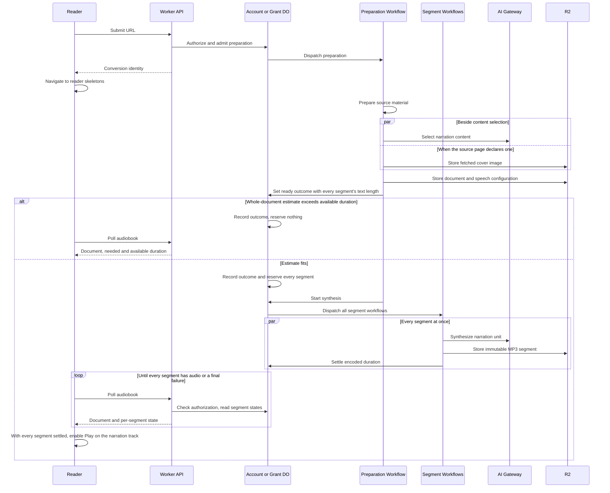

# Conversion from source URL to audiobook

The API admits preparation, an account or conversion grant owns allowance and outcomes, and Cloudflare Workflows runs durable processing steps. R2 stores the prepared narration document and one independently stored audio segment per synchronization unit. [ADR 0008](../adr/0008-synthesize-the-whole-narration-document.md) records why the whole document is synthesized as part of the conversion; [glossary](../GLOSSARY.md) defines the representations.

Two workflows run in the same Worker: [PrepareAudiobookWorkflow](../../libs/create-audiobook-from-url-workflow/src/prepare-audiobook-workflow.ts) prepares the document, and [SynthesizeAudioSegmentWorkflow](../../libs/create-audiobook-from-url-workflow/src/synthesize-audio-segment-workflow.ts) generates one segment. Each instance has a stable identity derived from its conversion, and for a segment its sequence, so dispatch, recovery, and retries resolve to the same instance. The [Worker configuration](../../apps/cloudflare-worker/wrangler.jsonc) declares their bindings.

Both runners act through a [conversion execution adapter](../../libs/create-audiobook-from-url-workflow/src/conversion-execution.ts) that captures the conversion owner, conversion ID, and execution epoch. The adapter does not cache lifecycle authorization: the owning Durable Object still checks every effect, and account writes also go through the account's fenced artifact writer.

## Preparation

After the server accepts the request and returns a conversion ID, the app navigates to the reader, which shows skeletons until preparation finishes. Preparation uses [source material](../../libs/prepare-source-material/), [narration selection](../../libs/narration-content-selection/), and [document creation](../../libs/narration-document-creation/). It stores the document with its speech configuration, so later generation and retries use the same model and voice, and records the preparation outcome together with every segment's text length. The owner reserves the whole document, or nothing, in the same transaction that records the outcome, so a prepared conversion never has undecided reservations; [`provider-failure.test.ts`](../../libs/create-audiobook-from-url-workflow/test/provider-failure.test.ts) covers both cases. As its final step the workflow asks the owner to dispatch the reserved segments. The owners store the outcome as `pending`, `ready`, or `failed`; the status shown to clients is derived from it together with the segment states.

Active accounts and open, unexpired conversion grants may prepare audiobooks without available duration; such an audiobook stays readable without audio. Per-owner admission limits still apply. A failed preparation shows an error and a Retry, which restarts preparation for the same conversion.

Narration content selection keeps complete paragraphs of main prose, including instructional prose, and leaves out code blocks and shell snippets; it reconstructs the source material from the original HTML, so source wording and native anchors are preserved. The [live evals](../../libs/narration-content-selection/test/evals/README.md) compare the resulting synchronization units exactly against committed goldens.

Preparation outcomes contain no audio duration or speech-provider usage; generated duration is recorded per segment by the owner's duration accounting. Grant outcomes additionally record narration measurements and content-selection provider usage for operator inspection.

## Cover image

Preparation keeps the cover image a source page declares in its metadata, when it can; [declaration extraction](../../libs/prepare-source-material/src/prepare-source-material.ts) reads Open Graph before Twitter metadata, never images in the source content, and prefers the rendered page's declaration, because a static shell often declares only a site-wide image. No client displays it yet: it is stored, recorded, and served, so a surface that shows it needs only client work.

A separate workflow step fetches the image while narration content is selected, in its own browser session after source preparation closed the first, so the two never overlap and the step stays self-contained and retryable; the manifest is stored only after both steps finish. A browser is used instead of a Worker `fetch` because publishers refuse non-browser clients: on 2026-10-13 Gates Notes answered a plain request carrying a browser user agent with `403 Access Denied`. The [browser fetch](../../libs/prepare-source-material/src/load-cover-image.ts) keeps only raster formats identified from the leading bytes, refuses SVG because it can carry scripts, and requires public destinations; [`load-cover-image.test.ts`](../../libs/prepare-source-material/test/load-cover-image.test.ts) covers these rules. Request interception does not see redirect hops, so a hop to a non-public host is detected only after the response and the result discarded; the same limitation applies to source pages.

Keeping the image is best-effort: a refusal, timeout, or browser failure leaves the audiobook without one, logged with its reason, and never fails the conversion. When preparation fails for another reason, the failure is recorded only after a running cover image step has finished, so the step cannot write into a conversion that is being cleaned up. Audiobooks prepared earlier have none and are not backfilled.

The image is copied rather than linked so that opening a private audiobook does not disclose the reader to the publisher, the content security policy can keep images same-origin, and the copy is erased with the account. Only the image the manifest records is served ([`trial-audiobook-access.test.ts`](../../libs/api-server/test/trial-audiobook-access.test.ts)); [R2 objects](r2-storage.md#objects-within-a-conversion) describes what is stored.

## Whole-document synthesis and accounting

Each synchronization unit maps to one narration chunk and one independently stored MP3 segment. Preparation limits a document's narration characters and units, which bounds a single dispatch.

The owner estimates every segment still lacking audio and reserves all of them in one transaction, or none when their sum exceeds the available duration, both when the ready outcome is recorded and whenever synthesis is started. Settled and reserved segments are left untouched, so one operation serves the first run, a retry of failed segments, and a retry after insufficient duration. An expired or revoked grant refuses new reservations while reserved work finishes. Starting synthesis dispatches one workflow per reserved segment under the owner's concurrency gate, so concurrent retries cannot restart each other's instances.

Dispatch does not pace instance creation across owners, so it does not enforce the Workflows creation rate limit; a refused creation is retried by the preparation workflow and the owner alarm, so segments start late rather than being lost. This is untested under load, and no ceiling limits concurrent synthesis.

Each segment workflow synthesizes, publishes, and settles independently, charging the actual encoded duration once and reusing audio a previous attempt already published. Transient provider errors are retried within the step, and a provider rate limit makes the workflow wait rather than fail. A segment that still fails releases only its own reservation and stores an explanation; completed segments stay stored and charged. A segment workflow never reserves for itself: the owner objects expose no per-segment reservation, so every reservation comes from the whole-document step.

While segments are reserved, the owner's alarm treats each reservation as synthesis still owed: it creates a missing workflow and restarts an errored one, and releases a reservation only when its workflow was terminated or errored after the account can no longer execute work ([`reconcile-segment-workflow.test.ts`](../../libs/conversion-contracts/test/reconcile-segment-workflow.test.ts)). [ADR 0003](../adr/0003-charge-for-accessible-generated-narration.md) defines capped overruns and free reuse. Synthesis runs on the server once started; leaving the reader does not stop it, and there is no cancellation.

## Status and retries

A prepared conversion's [status](../GLOSSARY.md#conversion-status) is derived from the owner's reservations and settlements, without querying workflows: a settled segment is ready, a reserved one is generating, a released one has failed, and a segment without a reservation means the document did not fit. The shared [status rule](../../libs/conversion-contracts/src/duration-accounting.ts) serves conversion detail and account history, and the [synthesis-state use case](../../libs/api-server/src/use-cases/get-synthesis-state.ts) applies it per segment ([`get-synthesis-state.test.ts`](../../libs/api-server/test/get-synthesis-state.test.ts)).

Operator grant inspection and a grant's conversion list still show the stored preparation outcome. One retry route restarts a failed preparation or, for a prepared conversion, starts synthesis again for whatever lacks audio, and reports the needed and available duration when it is refused. The reader enables Play and unit taps only once the audiobook has a narration track, that is once every segment has audio: a final failure marks the failed segments and offers Retry, and the audiobook is not playable until a retry succeeds. The document stays readable in every state; the [reader route tests](../../apps/web-app/src/routes/_shell.audiobooks.$conversionId.test.ts) cover these states, refused retries, and failed polls.

Sources: [preparation runner](../../libs/create-audiobook-from-url-workflow/src/run-prepare-audiobook-workflow.ts), [segment runner](../../libs/create-audiobook-from-url-workflow/src/run-audio-segment-workflow.ts), [segment dispatch and alarm reconciliation](../../libs/conversion-contracts/src/index.ts), [duration ledger](../../libs/duration-ledger/src/duration-ledger.ts), and [segment reuse](../../libs/audiobook-production/src/produce-audio-segment.ts).

## Playback

The web player plays the [narration track](../GLOSSARY.md#narration-track) with one `<audio>` element, on every platform ([ADR 0011](../adr/0011-serve-one-narration-track-and-play-it-with-one-audio-element.md)). The [player host](../../apps/web-app/src/app/player/player-host.ts) creates the element once for the app shell's lifetime, with `preload="metadata"` and no `crossOrigin`, because the signed URL carries its authorization. Loading an audiobook sets the track URL as the element's `src`, and loading another one sets its URL on the same element. The content security policy allows media only from the API origin's `/api/files/`.

- **State:** playing, buffering, position and duration are read from the element and its events; there is no player state machine. The [player](../../apps/web-app/src/app/player/narration-track-player.ts) adds only a position to apply once metadata is loaded and the failures of `play()` and saves.
- **Timeline:** the [timeline](../../apps/web-app/src/app/player/audiobook-timeline.ts) is the response's start offsets: every unit has an entry, and the current unit is the last one starting at or before `currentTime`, which drives the reader's highlight on every `timeupdate`. A unit tap and the position bar set `currentTime`; nothing swaps sources.
- **Play:** `play()` is called synchronously within the user gesture, because Mobile Safari refuses audio started after an await. After a media error, or once the track URL is older than 12 hours, Play first [renews the signed URL](authentication.md#signed-media-url) and resumes at the same position.
- **System media controls:** the player sets only the media session's metadata, the title and the cover image as artwork, and clears it on unload. It registers no action handlers and no position state, so the browser's defaults drive the lock screen and notification from the element.

[`player-host.test.ts`](../../apps/web-app/src/app/player/player-host.test.ts) covers these rules against a fake audio element, and the [app E2E suite](../../qa/e2e/test-e2e/conversion.test.ts) plays a served track in Chromium. The Android and iOS shells play through the web player in their WebView, best effort and untested on devices ([patricktree/cup#55](https://github.com/patricktree/cup/issues/55)); the shells have no native players. The operator checked lock-screen playback of the web player on an iPhone and an Android phone in production ([patricktree/cup#72](https://github.com/patricktree/cup/issues/72)).

## Delivery, positions, and lifecycle

The reader receives prepared text independently of segment states; [R2 access](r2-storage.md#access-and-lifecycle) states which objects can be delivered. The [delivery handlers](../../libs/api-server/src/http/serve-audiobook.ts) support HEAD and ETag requests, and audio also byte ranges. [Authentication](authentication.md) states who may read and replay.

Once every segment is settled, the audiobook has a narration track, served at `/api/files/audiobooks/{conversionId}/narration-track.mp3` through a [signed media URL](authentication.md#signed-media-url) ([ADR 0011](../adr/0011-serve-one-narration-track-and-play-it-with-one-audio-element.md)). The shared [status rule](../../libs/conversion-contracts/src/duration-accounting.ts) decides whether it exists; while any segment is reserved or failed, the route answers `narration-track-not-found` and the audiobook response omits `narrationTrack`. The audiobook response gives each segment's start in the track as the running sum of the settled durations before it.

- **Join:** the track is the stored segment objects, unchanged and concatenated in sequence order; nothing is stored for it. Every segment frame has the same length, so the layout (each segment's byte length and offset) derives from the settled durations alone ([byte-length rule](../../libs/audiobook-production/src/audio-format.ts)), without reading the manifest or R2.
- **Streaming:** the response reads one ranged R2 object per touched segment, the next only once the client has consumed the previous one, so a cancelled request stops reading. The first touched segment is read before headers are sent, so a missing object answers `500`; a later missing object, or any object whose size differs from its derived length, errors the stream. Each mismatch is logged with the conversion ID and sequence.
- **Ranges and caching:** single byte ranges, including suffix ranges, with the end clamped to the track; others answer `416`. The strong ETag hashes the conversion ID and the ordered durations, so HEAD, `If-None-Match` and `If-Range` need no R2 read. A stale `If-Range` gets the whole track.

[`narration-track.test.ts`](../../libs/api-server/test/narration-track.test.ts) covers these rules, and the [app E2E suite](../../qa/e2e/test-e2e/artifacts.ts) checks a served track built from synthesized segments. Segments are not delivered individually: the audiobook response reports only each segment's status, and the narration track is the only audio route.

Each signed-in listener has one saved position per conversion, a synchronization unit and an offset within its audio, which the server replaces on every save; anonymous positions stay on the device. Initial load restores it and stays paused; a loaded player is never moved by query refreshes or other devices' saves, so device switches resume from the last successful save. Local writes are serialized to keep their order. The web application's [`PlaybackSession`](../../apps/web-app/src/app/player/playback-session.ts) converts between a listening position and the track's `currentTime` through the start offsets; an unknown unit restores the start. It saves at most every five seconds while playing, on pause, on a seek, and when the audiobook is unloaded, in order; the request layer refuses a save for a user who is no longer signed in. [`playback-session.test.ts`](../../apps/web-app/src/app/player/playback-session.test.ts) covers the conversion and save ordering, and [`player-host.test.ts`](../../apps/web-app/src/app/player/player-host.test.ts) the cadence.

The web application holds one player for every page inside its [app shell](../../apps/web-app/src/routes/_shell.tsx), so playback continues while the listener moves between pages. Its [player host](../../apps/web-app/src/app/player/player-host.ts) holds at most one loaded audiobook, keeps it playing until the listener plays another, and unloads on leaving the shell or a change of the signed-in user (pause, remove `src`, `load()`), and is not restored after a reload; [`player-host.test.ts`](../../apps/web-app/src/app/player/player-host.test.ts) holds these rules. A loaded narration track never changes: it exists only once every segment has audio. Only its signed URL changes: [Play renews it](authentication.md#signed-media-url) before it expires.

Ownership parameters and account execution epochs fence segment generation and artifact writes, and the shared [artifact prefix](../../libs/conversion-contracts/src/artifact-prefix.ts) covers preparation, audio, delivery, and deletion. Retries do not make provider requests, R2 publication, owner settlement, and workflow dispatch atomic. See [account deletion](account-deletion.md) for cleanup responsibilities.
