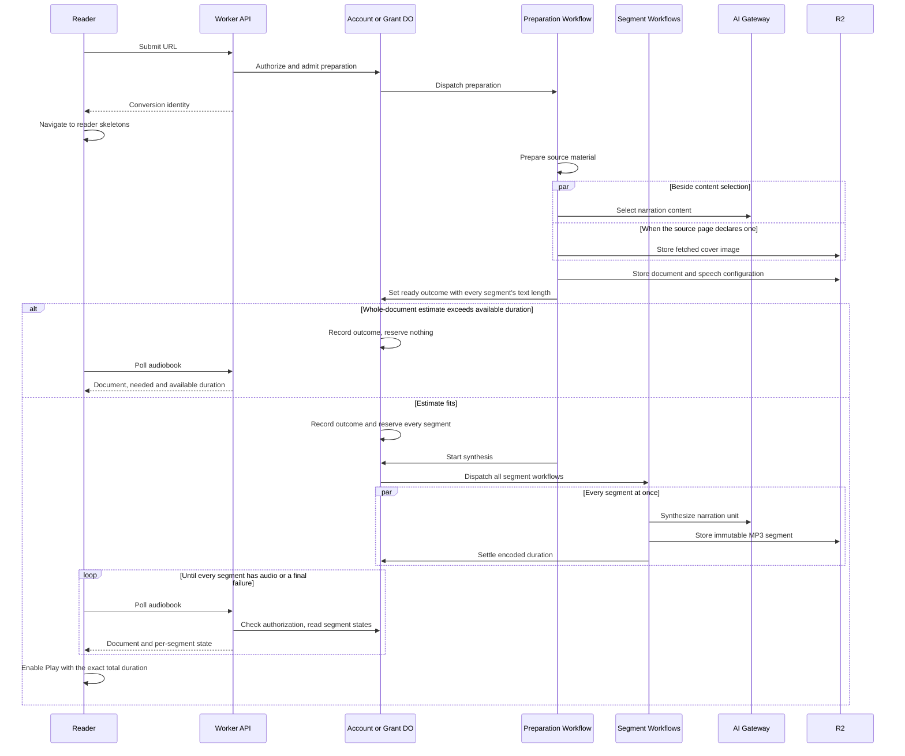
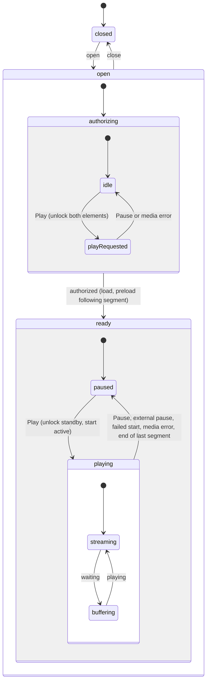

# Conversion from source URL to audiobook

The API admits preparation, an account or conversion grant owns allowance and outcomes, and Cloudflare Workflows runs durable processing steps. R2 stores the prepared narration document and one independently stored audio segment per synchronization unit. [ADR 0008](../adr/0008-synthesize-the-whole-narration-document.md) records why the whole document is synthesized as part of the conversion; [glossary](../GLOSSARY.md) defines the representations.

Two workflows run in the same Worker: [PrepareAudiobookWorkflow](../../libs/create-audiobook-from-url-workflow/src/prepare-audiobook-workflow.ts) prepares the document, and [SynthesizeAudioSegmentWorkflow](../../libs/create-audiobook-from-url-workflow/src/synthesize-audio-segment-workflow.ts) generates one segment. Each instance has a stable identity derived from its conversion, and for a segment its sequence, so dispatch, recovery, and retries resolve to the same instance. The [Worker configuration](../../apps/cloudflare-worker/wrangler.jsonc) declares their bindings. Runs of the former combined workflow are not moved into these workflows; settled audio remains reusable through the owner's ledger and stored artifacts.

Both runners act through a [conversion execution adapter](../../libs/create-audiobook-from-url-workflow/src/conversion-execution.ts) that captures the conversion owner, conversion ID, and execution epoch. The adapter does not cache lifecycle authorization: the owning Durable Object still checks every effect, and account writes also go through the account's fenced artifact writer.

## Preparation

After the server accepts the request and returns a conversion ID, the app navigates to the reader. The reader shows title and paragraph skeletons until preparation finishes. Preparation uses [source material](../../libs/prepare-source-material/), [narration selection](../../libs/narration-content-selection/), and [document creation](../../libs/narration-document-creation/). It stores the title, safe structured HTML, synchronization units, source URL, speech configuration, and a record of the cover image when one was kept, and records the preparation outcome together with every segment's text length. The owner reserves the whole document, or nothing, in the same transaction that records the outcome, so a prepared conversion never has undecided reservations. As its final step the workflow asks the owner to dispatch the reserved segments. The owners keep storing that outcome as `pending`, `ready`, or `failed`; the conversion status shown to clients is derived from it together with the segment states, as described below.

Active accounts and open, unexpired conversion grants may prepare audiobooks without available duration; such an audiobook stays readable without audio. Existing per-owner admission limits still apply. If preparation fails, the reader shows an error and a Retry button. Retry restarts preparation for the same conversion. Speech configuration is stored with the document so later generation and retries use the same choice (model, voice, ...).

Narration content selection retains complete paragraphs of main prose, including instructional prose, while excluding standalone code blocks and shell command snippets. Selection reconstructs narration source material from the original HTML, so source wording and native anchors are preserved. The [live evals](../../libs/narration-content-selection/test/evals/README.md) compare the resulting synchronization units exactly against committed goldens.

Generated audio duration is recorded per segment by the owner's duration accounting; preparation outcomes contain no audio duration or speech-provider usage. Grant outcomes additionally record narration text size, chunk count, and content-selection provider usage for operator inspection; account outcomes do not.

## Cover image

Preparation keeps the cover image a source page declares, when it can. No client displays it yet: it is stored, recorded, and served, so a surface that shows it needs only client work.

Source preparation reads the declaration from page metadata, Open Graph before Twitter, never from images in the source content. The rendered page load's declaration wins over the static load's, because a static shell often declares nothing or only a site-wide image. [Declaration extraction](../../libs/prepare-source-material/src/prepare-source-material.ts) defines the candidates and which declarations are unusable.

A separate workflow step fetches the image while narration content is selected, and the manifest is stored only after both finish. The step opens its own browser session after source preparation has closed the first, which keeps it self-contained and retryable; the two sessions never overlap. A browser is used instead of a Worker `fetch` because publishers refuse non-browser clients: on 2026-10-13 Gates Notes answered a plain request carrying a browser user agent with `403 Access Denied`.

The image is stored unchanged, and only when its leading bytes, not the response header, identify an accepted raster format within the size limit that the [browser fetch](../../libs/prepare-source-material/src/load-cover-image.ts) defines. SVG is refused because it can carry scripts. The URL and every redirect hop must be public destinations. Request interception does not see redirect hops, so a hop to a non-public host is detected after the response and the result discarded; the request to that hop has been made by then. The same limitation applies to source pages.

Keeping the image is best-effort. A refusal, a timeout, or a browser failure after the step's retries leaves the audiobook without a cover image and is logged with its reason; it never fails or delays the conversion beyond the step's bounds, and no client is told why. When preparation fails for another reason, the failure is recorded only after a running cover image step has finished, so the step cannot write into a conversion that is already being cleaned up. Audiobooks prepared before this behavior have none and are not backfilled.

The manifest records the stored image and the owner's ready outcome records that one exists. The audiobook response then carries a pointer to the [delivery route](#delivery-positions-and-lifecycle), and account history items carry the owner's flag. The image is copied rather than linked from the publisher so that opening a private audiobook does not disclose the reader to the publisher, the content security policy can keep images same-origin, and the copy is erased with the account. [R2 objects](r2-storage.md#objects-within-a-conversion) describes what is stored.

Sources: [cover image step](../../libs/create-audiobook-from-url-workflow/src/run-prepare-audiobook-workflow.ts) and [storage](../../libs/audiobook-production/src/store-cover-image.ts).

## Whole-document synthesis and accounting

Each synchronization unit maps to one narration chunk and one independently stored MP3 segment. Preparation limits a document's narration characters and units, which bounds a single dispatch.

The owner estimates every segment still lacking audio and reserves all of them in one transaction, or none when their sum exceeds the available duration. This happens when the ready outcome is recorded and again whenever synthesis is started. Settled and already reserved segments are left untouched, so the same operation serves the first run, a retry of failed segments, and a retry after insufficient duration. An expired or revoked grant refuses new reservations while reserved work finishes. Starting synthesis then dispatches one workflow per reserved segment, under the owner's concurrency gate so that concurrent retries cannot restart each other's instances, and restarts an instance that previously failed.

Dispatch bounds its requests in flight but does not pace them, and owners do not coordinate, so it does not enforce the Workflows limit on instance creations per second, which all conversions share. A creation refused for that limit fails the dispatch; the preparation workflow retries its dispatch step, and the owner alarm creates whatever is still missing, so the affected segments start late rather than being lost. This has not been observed or load-tested. No ceiling limits how many segments synthesize concurrently.

Each segment workflow synthesizes, publishes, and settles independently. Settlement uses the actual encoded duration and records each segment once; stored immutable audio is reused if a previous attempt already published it. Transient provider errors are retried within the step, and a provider rate limit makes the workflow wait and try again so a burst outlasts a per-minute limit rather than failing. A segment that still fails releases only its own reservation and stores an explanation; completed segments remain stored and charged. A segment workflow never reserves for itself: it runs only for a segment the owner reserved or already settled, so a reservation always comes from the whole-document step. The owner objects still expose a per-segment reservation that only tests call, so all-or-none reservation holds by convention rather than through their interfaces.

While segments are reserved, each owner's alarm treats a reservation as synthesis that is still owed. It creates the workflow of a reserved segment that has none and restarts one that errored, which recovers a dispatch that failed partway, including a retry's; a restarted run that fails again releases its own reservation. The alarm releases a reservation itself only when its workflow was terminated, or errored after the account can no longer execute work. [ADR 0003](../adr/0003-charge-for-accessible-generated-narration.md) defines capped overruns and free reuse.

Synthesis runs on the server once started. Leaving the reader does not stop it, and there is no cancellation.

A prepared conversion's status is derived from the owner's reservations and settlements, without querying workflows; `pending` and `failed` are the stored preparation outcome. Conversion detail and account history, including operator account inspection, use the shared [status rule](../../libs/conversion-contracts/src/duration-accounting.ts), and the [synthesis-state use case](../../libs/api-server/src/use-cases/get-synthesis-state.ts) derives the same statuses and every segment's state for the audiobook response:

| Status                  | Meaning                                                                                           |
| ----------------------- | ------------------------------------------------------------------------------------------------- |
| `pending`               | The narration document is being prepared                                                          |
| `failed`                | Preparation could not finish                                                                      |
| `insufficient-duration` | Prepared, but a segment has no reservation: the whole document did not fit the available duration |
| `synthesizing`          | At least one segment is reserved and being generated                                              |
| `ready`                 | Every segment has audio or a final failure                                                        |

A settled segment is ready, a reserved one is generating, and a released one has failed. Operator grant inspection and the list of a grant's conversions still show the stored preparation outcome. The response for `insufficient-duration` carries the needed and available durations. One retry route serves all cases: it restarts a failed preparation, and for a prepared conversion it starts synthesis again for whatever lacks audio. Its response says whether synthesis started or was refused for insufficient duration, with the needed and available durations. The reader shows a refusal for insufficient duration itself, because a refused retry of failed segments leaves the audiobook unchanged. An expired or revoked grant is refused as an error, which the reader reports with a toast and leaves the page as it was: the readable document, or the explanation of a failed preparation with its Retry. A failed status poll is reported the same way and does not replace the document.

The reader shows the document as soon as it is prepared. While synthesizing it shows the number of generated segments and keeps Play disabled. Play is enabled when the status is ready and every segment has audio. If segments failed, the reader marks them in the text and offers Retry and an explicit choice to play without them; Retry stays available afterwards. That choice gates playing, not loading the audiobook into the player. All-segment audio availability does not assemble a full track.

Sources: [preparation runner](../../libs/create-audiobook-from-url-workflow/src/run-prepare-audiobook-workflow.ts), [segment runner](../../libs/create-audiobook-from-url-workflow/src/run-audio-segment-workflow.ts), [segment dispatch and alarm reconciliation](../../libs/conversion-contracts/src/index.ts), [duration ledger](../../libs/duration-ledger/src/duration-ledger.ts), [grant ownership](../../libs/conversion-grants/src/durable-object/conversion-grant-durable-object.ts), and [segment reuse](../../libs/audiobook-production/src/produce-audio-segment.ts).

## Playback

Players build one whole-audiobook [timeline](../../apps/web-app/src/app/player/audiobook-timeline.ts) from the ready segments' durations, in document order. Segments without audio take no time, so the total duration is exact before playback starts. The position on that timeline is the sum of earlier segments plus the offset in the current one, and a seek is translated back to a segment and offset. Tapping a synchronization unit in the narration document seeks to its start and starts playback, loading its audiobook first when another one is loaded. Units with audio can also be played from the keyboard, and the document keeps its headings and paragraphs.

Players load the following segment before the current one ends, so a segment boundary has no loading pause. Silence contained in the audio itself is left as produced.

| Platform | Engine                                                                                                                                                        | Timeline in system media controls                                                 |
| -------- | ------------------------------------------------------------------------------------------------------------------------------------------------------------- | --------------------------------------------------------------------------------- |
| Browser  | Two alternating audio elements: one plays, the other preloads the following segment ([element pair](../../apps/web-app/src/app/player/audio-element-pair.ts)) | Media Session position state and seek handler                                     |
| Android  | A Media3 playlist with one item per segment                                                                                                                   | The session's player reports the whole duration and position and translates seeks |
| iOS      | A queue player holding the current and following segment                                                                                                      | Now-playing duration and elapsed time, and the change-playback-position command   |

Mobile Safari starts an audio element only after a user gesture, so the browser player starts playback synchronously within the Play action and starts the other element muted in the same action. An element that has no segment loaded yet plays a short same-origin silence file for this, because the content security policy does not allow data or blob media. A seek to a segment neither element has loaded loads it into the standby element and swaps to it, as at a segment boundary, because replacing the playing element's source makes Android browsers remove and recreate their media notification. This behavior and lock-screen continuity need verification on physical devices; component tests and native builds do not establish them.

The browser engine's modes are an XState [state machine](../../apps/web-app/src/app/player/audiobook-player-machine.ts) behind the `Player` contract; the element pair performs the element work the machine schedules. Element events count only in the states where they apply and only from the active element holding the current segment. The element starts that need the Play gesture run as actions of the transition handling Play, synchronously within the gesture, never in invoked or asynchronous actors.

Authorization after a Play request enters `playing` directly. An audiobook without audio opens straight into `ready`, where Play is ignored.

## Delivery, positions, and lifecycle

The reader receives prepared text independently of segment states; [R2 access](r2-storage.md#access-and-lifecycle) states which objects can be delivered. The [delivery handlers](../../libs/api-server/src/http/serve-audiobook.ts) support HEAD and ETag requests, and audio also byte ranges. [Authentication](authentication.md) states who may read and replay, including [trial access](authentication.md#trial-access).

Each signed-in listener has one saved position per conversion: synchronization unit ID and offset within that unit's audio. The server replaces it on every save. Initial player load restores it and remains paused. A unit whose segment has no audio resumes at the start of the next unit with audio, and a unit that is unknown or follows the last audio starts the audiobook from the beginning. The web application resolves this rule in its [`PlaybackSession`](../../apps/web-app/src/app/player/playback-session.ts) and hands native engines the resolved position; the native coordinators also implement it and restore anonymous positions from device storage. Subsequent query refreshes and other devices' saves never move a loaded player. Replacing a loaded audiobook with a newer version of itself, after a retry produced missing audio, keeps the player's current position instead. Local writes are serialized to retain their order. Anonymous positions are stored on the browser or native device. Positions are saved periodically during playback and on pause or seek, so device switches resume from the last successful write. A save for a signed-in listener is refused when another user is signed in by the time it is sent.

The API reads and dispatches through [conversion readers](../../libs/api-server/src/adapters/conversion-reader.ts) and [conversion dispatch adapters](../../libs/api-server/src/adapters/conversion-dispatch.ts) bound to the owning conversion, while request authentication and operation-specific authorization stay in the HTTP handlers. The signed-in listener is resolved separately from the owner because an account can hold a listening position for a grant-owned conversion.

The web application holds one player for every page inside its [app shell](../../apps/web-app/src/routes/_shell.tsx), so playback continues while the listener moves between an audiobook, their conversion history, and their account. Its [player host](../../apps/web-app/src/app/player/player-host.ts) owns the playback rules:

- It holds at most one loaded audiobook. It loads the shown audiobook, paused, only while nothing is loaded and once a restored account is known, using the server listening position for a signed-in listener and the device one otherwise.
- Another loaded audiobook keeps playing until the listener plays the shown one, which saves the previous position and replaces it.
- When a newer ready version of the loaded audiobook has more segments with audio, as after a retry, the host swaps it in once playback pauses, because a new player could start only from a user gesture.
- Leaving the shell for the start or trial page unloads the player, as does a change of the signed-in user. The player is not restored after a reload.
- The choice to play without failed segments belongs to the page showing the audiobook until it is loaded and is forgotten when the page closes or the signed-in user changes.

Each load creates a `PlaybackSession` for that audiobook and the signed-in user it was loaded for. It checks that user, authorizes media, converts between the listening position and the timeline, and paces position saves. A [browser](../../apps/web-app/src/app/player/audiobook-player.ts) or [native](../../apps/web-app/src/platform/native-player.ts) engine, selected per platform, only plays segments on its timeline. Native Android and iOS playback coordinators own playback intent and the timeline while their WebViews are suspended; see [native playback components](../../apps/mobile-app/README.md#playback). Operating systems may suspend browsers, and native lock-screen continuity still needs physical-device verification. A native authorization expiry fails subsequent media and position requests until playback is reauthorized.

Ownership parameters and account execution epochs fence segment generation and artifact writes. The shared [artifact prefix](../../libs/conversion-contracts/src/artifact-prefix.ts) covers preparation, audio, delivery, and deletion. Account lifecycle state is checked on new private requests; deletion fences late writes. Retries do not make provider requests, R2 publication, owner settlement, and workflow dispatch atomic. See [account deletion](account-deletion.md) for cleanup responsibilities.
