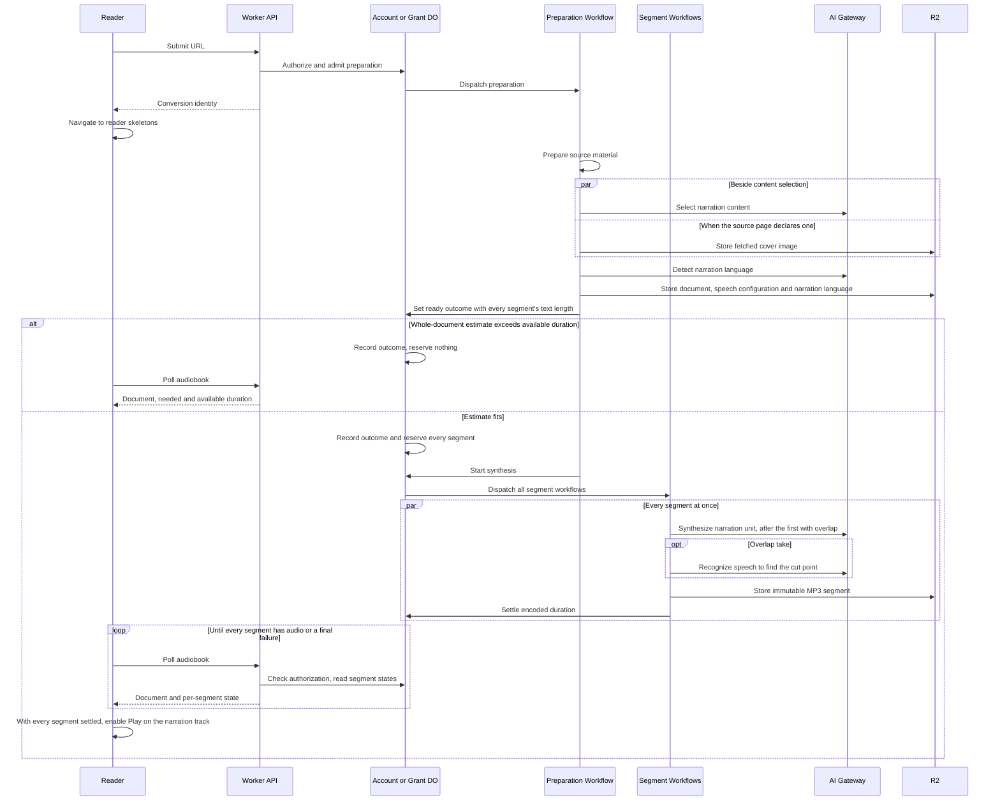

# Conversion from source URL to audiobook

The API admits preparation, an account or conversion grant owns allowance and outcomes, and Cloudflare Workflows runs durable processing steps. R2 stores the prepared narration document and one independently stored audio segment per synchronization unit. [ADR 0008](../adr/0008-synthesize-the-whole-narration-document.md) records why the whole document is synthesized as part of the conversion; [glossary](../GLOSSARY.md) defines the representations.

Two workflows run in the same Worker: [PrepareAudiobookWorkflow](../../libs/create-audiobook-from-url-workflow/src/prepare-audiobook-workflow.ts) prepares the document, and [SynthesizeAudioSegmentWorkflow](../../libs/create-audiobook-from-url-workflow/src/synthesize-audio-segment-workflow.ts) generates one segment. Each instance has a stable identity derived from its conversion, and for a segment its sequence, so dispatch, recovery, and retries resolve to the same instance. The [Worker configuration](../../apps/cloudflare-worker/wrangler.jsonc) declares their bindings.

Both runners act through a [conversion execution adapter](../../libs/create-audiobook-from-url-workflow/src/conversion-execution.ts) that captures the conversion owner, conversion ID, and execution epoch. The adapter does not cache lifecycle authorization: the owning Durable Object still checks every effect, and account writes also go through the account's fenced artifact writer.

[Open this diagram in Mermaid Live](https://mermaid.live/view#pako:eJyNVk2P4jgQ_SulXPYCl9lbDkhsMxq1NLuNaI1aWnGptiuJhePK2mVoZjT_feV8QEJAak5xXB-vXr2q8CtTrCnLs0D_RXKKNgZLj_XeAQA06MUo06ATeLKGnAAG2BFq8nOL9fY5Xb-xP5BPp7nJy8mRT0ZrpTg6AfbwzaebzcvceuupQY9i2CWf8TElKSyf5k6vVNY90OFxMA53MLeQ18_wDYVOeJ5b7L5077r6l6vVevucw2t8r43Aj9337na9fV6uVm15OayjVOzNTwJ0GlAny-YKvvNobZer1aiqHDYmNCiqmpunBMvVqkORwxO7I_mQqDCanBg538AcLP_BoylRCITBt52DcCBLwq7nY4TgFk93IAgcvSKoUcgbtBeW4C8KRhModpKYDmRJXUHPo68Td60ROPR9M3vvzidR9laRA6kueRssCTQpi54CsKNH4XdfcngV9gQFiapIg-IjeTA1lr0TOX2v7ARsQzIFZtGV8eL5KJVmFZPOFhAaIlWlegpTxkG5Tn8yZC-fV5K2U2fgKIprgpORCuhI_gyh0_QfAYQ-BCy5UqqeOSvwVrGl5YAIKIhJTQP6UEQ6AB7RWHy3BDqO5TVWZA9jR4q9HjAswFMgfyRwLJVx5dVvOhlbthYwasPvzIer1Y2ANxfSHJEm3Y3KA3RkA8HXoZbCSPgk6jbqAHxC4CMFDT0Q9ALh7KSiYO6k63fLaGTR2iE4nKYbZ5iWr2MEgALs1EjL6dfHHUalB_CTRhKKzsgCsBDy7ZAUxgfpNJLEbrGZhuRG4KW7AMHDTcJ50kRh6VLOXs_CUBin22QqCjRsxgROpmoe8joopq6jtO39e_vnvBFTt-swiCUgl75T-o5qJ5ktcwM_nBg77TZUGDpRpi8OpnLQQoHGRn_Dx-fUDLc7_6kidQDsN3-LcdFO8QVCEBQK8xB3hqKVbUN-OfF9UPNs47_NtgWElkW9AHIt_1uLZ-Bux16FJR7V4bIls0VWk6_R6CzPfqXX-0wqqmmf5bDPPOn4sVRs2e-zvfudLbLYaJThH0SWi4-0yEqfAnTPDbp_mS9XnmNZZXmBNtDv_wGk59f6)

## Preparation

After the server accepts the request and returns a conversion ID, the app navigates to the reader, which shows skeletons and a status line with the preparation phase until preparation finishes. Preparation uses [source material](../../libs/prepare-source-material/), [narration selection](../../libs/narration-source-analysis/), and [document creation](../../libs/narration-document-creation/). It stores the document with its speech configuration and [narration language](#narration-language), so later generation and retries use the same model and voice, and records the preparation outcome together with every segment's text length. The owner reserves the whole document, or nothing, in the same transaction that records the outcome, so a prepared conversion never has undecided reservations; [`provider-failure.test.ts`](../../libs/create-audiobook-from-url-workflow/test/provider-failure.test.ts) covers both cases. As its final step the workflow asks the owner to dispatch the reserved segments. The owners store the outcome as `pending`, `ready`, or `failed`; the status shown to clients is derived from it together with the segment states.

Both owners record each conversion's [preparation phase](../GLOSSARY.md#preparation-phase): accepting or retrying a conversion records the start, and the preparation workflow records each later phase as it starts it. An account checks the workflow's execution epoch and records the phase in one call, so work fenced by account deletion records nothing. While a conversion is pending, the audiobook response and account history report its preparation phase, mapped from the internal phase by the [listener responses](../../libs/api-server/src/http/listener-responses.ts) ([`listener-responses.test.ts`](../../libs/api-server/test/listener-responses.test.ts)). Clients read a phase they do not know as no phase. The phase is the last one started, not a measure of progress.

Active accounts and open, unexpired conversion grants may prepare audiobooks without available duration; such an audiobook stays readable without audio. Per-owner admission limits still apply. A failed preparation shows an error and a Retry, which restarts preparation for the same conversion.

[Source preparation](../../libs/prepare-source-material/src/prepare-source-material.ts) loads each source page twice, without and with JavaScript, and keeps the better load. In each load the browser marks the [visible headline](../GLOSSARY.md#visible-headline), whose text becomes the [source title](../GLOSSARY.md#source-title), and the source material is cut there: the visible headline and everything before it in document order are left out, so content selection never sees kickers, hub links or dates above the title. Without a visible headline the document title is the source title, nothing is cut, and there is no source subtitle.

Each load then detects the [source subtitle](../GLOSSARY.md#source-subtitle) by [deterministic rules](../../libs/prepare-source-material/src/source-subtitle.ts), without an LLM call:

- Detection runs after the cleanup that removes irrelevant elements such as navigation, figures, buttons and forms, so none of them is ever a candidate.
- There is one candidate, the first prose block after the visible headline that is not a date or byline. If its signals do not accept it, there is no source subtitle and no further block is tried: precision beats recall, and a missing source subtitle never fails or delays a conversion.
- The accepted element is removed from the source material by identity, not by matching its text, and the source subtitle travels beside the source title of the same load, so it always belongs to the narrated HTML.

The [recorded source pages](../../libs/prepare-source-material/test-e2e/fixtures/README.md) and the [unit tests](../../libs/prepare-source-material/test/prepare-source-material.test.ts) cover each acceptance and rejection rule.

Each load also reads the source page's [declared language](../GLOSSARY.md#declared-language), its `<html lang>` and `og:locale`, and the kept load's declaration travels with the source material. Both values are passed on as declared, malformed ones included, and each is absent when the page does not declare it; validating them is left to [narration language](#narration-language) detection, which uses it as evidence.

Narration content selection keeps complete paragraphs of main prose, including instructional prose, and leaves out code blocks and shell snippets; it reconstructs the source material from the original HTML, so source wording and native anchors are preserved. The [live evals](../../libs/narration-source-analysis/test/evals/README.md) compare the resulting synchronization units exactly against committed goldens.

[Narration document creation](../../libs/narration-document-creation/src/narration-document-creation.ts) opens every narration document with the source title as its first synchronization unit. With a source subtitle, the source title and the source subtitle open it together in an `<hgroup>` as two units, so the source subtitle is narrated second, as a unit of its own that never takes in a heading or the next block, and the detail view shows it under the source title, above the host. The narration document is the only carrier of the source subtitle: the audiobook manifest and the listener API carry the source title alone, so Recents, the player sheet and the media session show only the source title ([ADR 0014](../adr/0014-cut-source-material-at-the-visible-headline-and-carry-the-source-subtitle-in-the-narration-document.md)).

[Narration chunking](../../libs/narration-document-creation/src/narration-chunking.ts) splits a narration block longer than 2,000 characters into several narration chunks at sentence boundaries, falling back to word boundaries, and each chunk becomes a synchronization unit of its own. Every unit after the first one of such a split block carries `continuesNarrationBlock: true`; every other unit leaves the field out, so segment synthesis can tell a split mid-paragraph from a break between narration blocks. The field is optional in the strict unit schema, so manifests prepared before it existed load unchanged and are read as not continuing. The listener API maps unit fields explicitly and does not expose it. [`narration-chunking.test.ts`](../../libs/narration-document-creation/test/narration-chunking.test.ts) and [`narration-document-creation.test.ts`](../../libs/narration-document-creation/test/narration-document-creation.test.ts) cover which units carry it.

Preparation outcomes contain no audio duration or speech-provider usage; generated duration is recorded per segment by the owner's duration accounting. Grant outcomes additionally record narration measurements and content-selection provider usage for operator inspection.

## Narration language

Every new conversion gets its [narration language](../GLOSSARY.md#narration-language) once, in a "detect narration language" step after the narration document is created. [Detection](../../libs/narration-source-analysis/src/narration-language-detection.ts) asks the selection model, at low reasoning effort, for the language subtag of the majority of the narrated text. It reads the source title, the start of the narration source material's text, and the declared language as labelled evidence, so a site template that declares the wrong language does not decide it ([ADR 0002](../adr/0002-use-gemini-for-narration-content-selection.md)).

Deterministic code, not the prompt, turns the answer into the narration language, a canonical BCP 47 tag:

- A region is added only when the valid declared language has the same language subtag with one: `fr` with a declared `fr-CA` gives `fr-CA`, `fr` with a declared `de-DE` gives `fr`. `<html lang>` wins over `og:locale`, whose underscore form is converted to BCP 47 first.
- A tag is valid only when its language subtag is a 2–3 letter ISO 639 code that `Intl` can name, so a language name such as `German`, which BCP 47 parses as a long subtag, is an invalid tag, as are `und` and the other special codes. The same rule decides whether a declared language is valid.
- When the call fails, gives no answer or gives an invalid tag, the valid declared language is used; without one, the conversion has no narration language. Detection never fails a conversion.
- Two rules apply last, to the detector's answer and to a fallback alike. German is narrated as `de-DE`: any narration language with language subtag `de` becomes exactly `de-DE`, so `de` with a declared `de-AT` gives `de-DE`. This was decided on 2026-11-09 after listening to derStandard conversions in production, whose Austrian accent and too-strong "R" sounded unpleasant ([#223](https://github.com/patricktree/cup/issues/223)). English without a region is narrated as `en-GB`: `en` becomes `en-GB`, while English with a region, such as `en-US`, keeps it. Other languages keep the region rule, and a conversion without a narration language stays without one. Neither rule is a fallback. Conversions prepared earlier keep their stored narration language, such as `de-AT`.
- The call is not retried inside detection; the step runs with the AI step configuration, so transient errors get the workflow's step retries before detection falls back.

The narration language is written once, to the audiobook manifest that the "store audiobook" step stores before synthesis starts, as a top-level field beside the speech configuration, which stays a deployment constant. It is absent when there is none. Every fallback logs one `narration-language-fallback` warning with the conversion ID, the declared language, the chosen narration language and the reason (`detector-error`, `no-answer` or `invalid-tag`), and with `detector-error` also the root cause of the detector call's error as `error`; a successful detection logs nothing. A valid narration language that the deployment's speech model cannot speak is not a fallback: it stays the narration language, and preparation logs a separate `narration-language-unspeakable` warning with the conversion ID, the narration language, and the speech provider and model, also after a fallback to such a language. A speech provider that ignores the narration language, ElevenLabs, logs no such warning. [`provider-failure.test.ts`](../../libs/create-audiobook-from-url-workflow/test/provider-failure.test.ts) covers the stored language and both warnings. The ready outcome stores a copy of the manifest's narration language ([Durable Object storage](durable-object-storage.md)), which operators see per history entry in [account inspection](../../apps/operator/README.md#narration-languages).

Each segment workflow takes the narration language only from the manifest it loads, never from preparation's step output, so retried segments keep the stored language. New conversions are prepared with Gemini speech policy 7, which sends the request of policies 5 and 6 apart from the [overlap](#overlap-and-cut) in front of the narration chunk: when the [speakability check](../../libs/audiobook-production/src/narration-language-speakability.ts) finds the language among those Google lists for Flash-Lite TTS, [the request](../../libs/audiobook-production/src/synthesize-gemini-audio.ts) sets `generation_config.speech_config[0].language` to the tag and gives the text part an unspoken `speech_metadata.style`, "Read in German with standard German pronunciation." for `de-DE`, naming the language without its region. The check is Cup's own because Gemini fails a request with a malformed tag but silently accepts a well-formed one for a language Flash-Lite does not list ([Gemini TTS language and instructions](../research/gemini-tts-language.md)). The style, not the language parameter, is what makes a names-only segment such as a byline sound like the narration language ([listening prototype](../research/narration-language-by-ear.md)). A passage clearly in another language gets no handling of its own; Gemini speaks it in its own language. Without a speakable narration language, and for manifests prepared with policy 3 or 4, the request is unchanged; a manifest from before the speech configuration was recorded loads as policy 4. ElevenLabs ignores the narration language, so the speakability check reports every language as ignored there, neither speakable nor unspeakable. A Gemini model without registered languages fails the check instead of finding every language unspeakable, so changing the model requires registering its languages. Policies 3 to 6 are recognized by their whole speech configuration, the comparison segment reuse makes. [`narration-language-speakability.test.ts`](../../libs/audiobook-production/test/narration-language-speakability.test.ts) covers the check and [`gemini-narration-language.test.ts`](../../libs/audiobook-production/test/gemini-narration-language.test.ts) covers the request shapes.

Speech policies 6 and 7 also set a narration pace of ×1.05: [segment production](../../libs/audiobook-production/src/produce-audio-segment.ts) time-stretches the provider PCM with [Sonic](../../libs/time-stretching/), keeping its pitch, before MP3 encoding ([time-stretch technology](../research/time-stretch-technology.md)), so the stored audio, its generated audio duration, the narration track and the synchronization unit offsets all carry the faster narration pace ([ADR 0023](../adr/0023-time-stretch-narration-audio-after-synthesis-with-sonic.md)). The factor follows from the policy, not from a field of the speech configuration, and every other policy, ElevenLabs included, stores the provider audio unstretched, so a manifest prepared with policy 5 keeps its narration pace for every remaining and retried segment. [`produce-audio-segment.test.ts`](../../libs/audiobook-production/test/produce-audio-segment.test.ts) covers the stretched and unstretched durations and that segment reuse never crosses policies.

## Overlap and cut

Under speech policy 7 narration carries on across each [segment boundary](../GLOSSARY.md#segment-boundary) instead of making a fresh start there ([ADR 0027](../adr/0027-flow-narration-across-segment-boundaries-with-overlap-and-cut.md)). [Segment production](../../libs/audiobook-production/src/synthesize-with-overlap-and-cut.ts) synthesizes every audio segment after the first with the previous narration chunk's last whole sentence in front of its own narration chunk, joined by a space when the unit continues a split narration block and by a paragraph break otherwise. Each segment workflow reads that previous unit from the manifest it loads, never from another segment's output, so segments still synthesize in parallel and retry one at a time. The first segment gets no overlap and no speech recognition.

[Speech recognition](../GLOSSARY.md#speech-recognition), Whisper large v3 turbo through the Worker's `AI` binding and AI Gateway with the synthesis request's metadata, transcribes the provider audio of the [overlap take](../GLOSSARY.md#overlap-take) with word timings. A [pure module](../../libs/audiobook-production/src/find-cut-point.ts) aligns the recognized words with the synthesized text and places the [cut point](../GLOSSARY.md#cut-point) in the middle of the longest silent run between the aligned words on either side of the chunk's start: from where the overlap's last aligned word starts to where the chunk's first aligned word starts, since Whisper stretches word ends over pauses and a cut after the chunk's first word would drop it. Silence at the start of that span lies before the overlap's last word and is skipped: Whisper can start that word early, such as at 0 s before the take's lead-in silence. Whisper splits some words into pieces, such as "1,173" into "1" and ",173"; a piece without leading whitespace that opens with punctuation is joined to the word before it, so numbers and hyphenated compounds align. The [cut check](../GLOSSARY.md#cut-check) accepts it only when it lies between the overlap's last aligned word and the chunk's first, an aligned word sits at most two words from the chunk's start on each side, and the silent run lasts at least 150 ms. The provider audio from the cut point on is then stretched, encoded and stored as under policy 6, so the stored audio, its generated audio duration and the charge cover only the segment's own narration chunk. The recognized words are never stored and are not [spoken text](../GLOSSARY.md#spoken-text).

- **Fallback.** When no cut point is found or the cut check rejects it, the same attempt synthesizes the narration chunk alone, as policy 6 does, so one attempt runs at most two syntheses and one speech recognition, within the segment step's 5-minute timeout. A cut failure never fails a segment.
- **Speech recognition languages.** The conversion's narration language gives Whisper its [language code](../../libs/audiobook-production/src/speech-recognition-language.ts), looked up by its language subtag in Whisper's own list of 100 languages, whether or not Gemini gets a language tag for it, so Swedish, Finnish and Ukrainian get overlap. Whisper takes `tl`, `no` and `jw` for `fil`, `nb` and `jv`, and Southern Pashto `pbt` as Pashto `ps`; close variants that Whisper writes differently, Egyptian Arabic `arz` and South Azerbaijani `azb`, are not on the list. A narration language off the list gets no overlap for any segment; without a narration language Whisper detects the language itself and the fallback covers a miss.
- **Errors.** A speech recognition error is classified like a synthesis provider error: a rate limit waits, a transient error gets the step's retries, which start again with overlap, and a permanent one, a response that does not parse included, fails the segment. A recognition outage never falls back silently. A recognized word without its text or timing is left out, so alignment and the cut check decide whether the remaining words place a cut point.
- **Logs.** Every fallback logs an `overlap-and-cut-fallback` warning with the conversion ID, sequence, synthesis attempt and reason (`no-cut-point`, `cut-check-failed` or `language-unrecognized`). Whether a stored segment has overlap is not recorded.

[`produce-audio-segment.test.ts`](../../libs/audiobook-production/test/produce-audio-segment.test.ts), [`find-cut-point.test.ts`](../../libs/audiobook-production/test/find-cut-point.test.ts) and [`provider-failure.test.ts`](../../libs/create-audiobook-from-url-workflow/test/provider-failure.test.ts) cover the requests, the cut, the fallback and the errors, and that a conversion prepared under policy 6 keeps it for retried segments. The paid [speech recognition evals](../../libs/audiobook-production/test/evals/README.md) run real Whisper through a Workers AI binding on recorded overlap takes and check the binding's response shape and the cut check's decision on each take.

## Cover image

Preparation keeps the cover image a source page declares in its metadata, when it can; [declaration extraction](../../libs/prepare-source-material/src/prepare-source-material.ts) reads Open Graph before Twitter metadata, never images in the source content, and prefers the rendered page's declaration, because a static shell often declares only a site-wide image. No client displays it yet: it is stored, recorded, and served, so a surface that shows it needs only client work.

A separate workflow step fetches the image while narration content is selected, in its own browser session after source preparation closed the first, so the two never overlap and the step stays self-contained and retryable; the manifest is stored only after both steps finish. A browser is used instead of a Worker `fetch` because publishers refuse non-browser clients: on 2026-10-13 Gates Notes answered a plain request carrying a browser user agent with `403 Access Denied`. The [browser fetch](../../libs/prepare-source-material/src/load-cover-image.ts) keeps only raster formats identified from the leading bytes, refuses SVG because it can carry scripts, and requires public destinations; [`load-cover-image.test.ts`](../../libs/prepare-source-material/test/load-cover-image.test.ts) covers these rules. Request interception does not see redirect hops, so a hop to a non-public host is detected only after the response and the result discarded; the same limitation applies to source pages.

Keeping the image is best-effort: a refusal, timeout, or browser failure leaves the audiobook without one, logged with its reason, and never fails the conversion. When preparation fails for another reason, the failure is recorded only after a running cover image step has finished, so the step cannot write into a conversion that is being cleaned up. Audiobooks prepared earlier have none and are not backfilled.

The image is copied rather than linked so that opening a private audiobook does not disclose the reader to the publisher, the content security policy can keep images same-origin, and the copy is erased with the account. Only the image the manifest records is served ([`trial-audiobook-access.test.ts`](../../libs/api-server/test/trial-audiobook-access.test.ts)); [R2 objects](r2-storage.md#objects-within-a-conversion) describes what is stored.

## Whole-document synthesis and accounting

Each synchronization unit maps to one narration chunk and one independently stored MP3 segment. Preparation limits a document's narration characters and units, which bounds a single dispatch.

The owner estimates every segment still lacking audio and reserves all of them in one transaction, or none when their sum exceeds the available duration, both when the ready outcome is recorded and whenever synthesis is started. Settled and reserved segments are left untouched, so one operation serves the first run, a retry of failed segments, and a retry after insufficient duration. An expired or revoked grant refuses new reservations while reserved work finishes. Starting synthesis dispatches one workflow per reserved segment under the owner's concurrency gate, so concurrent retries cannot restart each other's instances.

Dispatch does not pace instance creation across owners, so it does not enforce the Workflows creation rate limit; a refused creation is retried by the preparation workflow and the owner alarm, so segments start late rather than being lost. This is untested under load, and no ceiling limits concurrent synthesis.

Each segment workflow synthesizes, publishes, and settles independently, charging the actual encoded duration once and reusing audio a previous attempt already published. Transient provider errors are retried within the step, and a provider rate limit makes the workflow wait rather than fail. A segment that still fails releases only its own reservation and stores an explanation; completed segments stay stored and charged. A segment workflow never reserves for itself: the owner objects expose no per-segment reservation, so every reservation comes from the whole-document step.

While segments are reserved, the owner's alarm treats each reservation as synthesis still owed: it creates a missing workflow and restarts an errored one, and releases a reservation only when its workflow was terminated or errored after the account can no longer execute work ([`reconcile-segment-workflow.test.ts`](../../libs/conversion-contracts/test/reconcile-segment-workflow.test.ts)). [ADR 0003](../adr/0003-charge-for-accessible-generated-narration.md) defines capped overruns and free reuse. Synthesis runs on the server once started; leaving the reader does not stop it, and there is no cancellation.

## Status and retries

A prepared conversion's [status](../GLOSSARY.md#conversion-status) is derived from the owner's reservations and settlements, without querying workflows: a settled segment is ready, a reserved one is generating, a released one has failed, and a segment without a reservation means the document did not fit. The shared [status rule](../../libs/conversion-contracts/src/duration-accounting.ts) serves account history, and the [synthesis-state use case](../../libs/api-server/src/use-cases/get-synthesis-state.ts) applies it per segment ([`get-synthesis-state.test.ts`](../../libs/api-server/test/get-synthesis-state.test.ts)).

Operator grant inspection and a grant's conversion list still show the stored preparation outcome. One retry route restarts a failed preparation or, for a prepared conversion, starts synthesis again for whatever lacks audio, and reports the needed and available duration when it is refused. The audiobook is playable only once it has a narration track, that is once every segment has audio: a final failure marks the failed segments and offers Retry, and the audiobook is not playable until a retry succeeds. The reader offers Retry only where it would start work, that is after a failed preparation, a refusal for lack of duration, or a final segment failure: never while preparation or synthesis runs, and not once every segment has audio. The document stays readable in every state; the [reader route tests](../../apps/web-app/src/routes/_shell.audiobooks.$conversionId.test.ts) cover how the reader presents these states, refused retries, and failed polls.

Sources: [preparation runner](../../libs/create-audiobook-from-url-workflow/src/run-prepare-audiobook-workflow.ts), [segment runner](../../libs/create-audiobook-from-url-workflow/src/run-audio-segment-workflow.ts), [segment dispatch and alarm reconciliation](../../libs/conversion-contracts/src/index.ts), [duration ledger](../../libs/duration-ledger/src/duration-ledger.ts), and [segment reuse](../../libs/audiobook-production/src/produce-audio-segment.ts).

## Playback

The web player plays the [narration track](../GLOSSARY.md#narration-track) with one `<audio>` element, on every platform ([ADR 0011](../adr/0011-serve-one-narration-track-and-play-it-with-one-audio-element.md)). The [player host](../../apps/web-app/src/app/player/player-host.ts) creates the element once for the app shell's lifetime and sets each loaded audiobook's track URL as its `src`; the signed URL carries the authorization, and the content security policy allows media only from the API origin's `/api/files/`.

- **State:** the element and its events are the player state; there is no player state machine.
- **Timeline:** the response's start offsets map `currentTime` to the current unit, which drives the reader's highlight; seeking sets `currentTime` and nothing swaps sources. A seek waits until the element reports a duration above 0, because WebKit's GStreamer media backend on Linux first reports 0, and a seek then can end playback at once; the next media event that finds the duration known applies it.
- **Play:** `play()` is called synchronously within the user gesture, because Mobile Safari refuses audio started after an await. A stale or failed track URL is [renewed](authentication.md#signed-media-url) first.
- **System media controls:** the player sets only the media session's metadata and registers no action handlers, so the browser's defaults drive the lock screen and notification from the element.

[`player-host.test.ts`](../../apps/web-app/src/app/player/player-host.test.ts) covers these rules against a fake audio element, and the [app E2E suite](../../qa/e2e/test-e2e/conversion.test.ts) plays a served track in Chromium and WebKit. The Android and iOS shells play through the web player in their WebView, best effort and untested on devices ([patricktree/cup#55](https://github.com/patricktree/cup/issues/55)); the shells have no native players. The operator checked lock-screen playback of the web player on an iPhone and an Android phone in production ([patricktree/cup#72](https://github.com/patricktree/cup/issues/72)).

## Delivery, positions, and lifecycle

The reader receives prepared text independently of segment states; [R2 access](r2-storage.md#access-and-lifecycle) states which objects can be delivered. The [delivery handlers](../../libs/api-server/src/http/serve-audiobook.ts) support HEAD and ETag requests, and audio also byte ranges. [Authentication](authentication.md) states who may read and replay.

Once every segment is settled, the audiobook has a narration track, served at `/api/files/audiobooks/{conversionId}/narration-track.mp3` through a [signed media URL](authentication.md#signed-media-url) ([ADR 0011](../adr/0011-serve-one-narration-track-and-play-it-with-one-audio-element.md)). The shared [status rule](../../libs/conversion-contracts/src/duration-accounting.ts) decides whether it exists, and the audiobook response gives each segment's start in the track as the running sum of the settled durations before it.

- **Join:** the track is the stored segment objects, unchanged and concatenated in sequence order; nothing is stored for it. Every segment frame has the same length, so the layout (each segment's byte length and offset) derives from the settled durations alone ([byte-length rule](../../libs/audiobook-production/src/audio-format.ts)), without reading the manifest or R2.
- **Streaming and caching:** the response reads one ranged R2 object per touched segment, pulled as the client consumes, and its ETag derives from the conversion ID and the ordered durations, so HEAD and conditional requests need no R2 read. The [delivery handler](../../libs/api-server/src/http/serve-audiobook.ts) holds the range, error and logging rules.

[`narration-track.test.ts`](../../libs/api-server/test/narration-track.test.ts) covers these rules, and the [app E2E suite](../../qa/e2e/test-e2e/artifacts.ts) checks a served track built from synthesized segments. Segments are not delivered individually: the audiobook response reports only each segment's status, and the narration track is the only audio route.

Each signed-in listener has one saved position per conversion, a synchronization unit and an offset within its audio, which the server replaces on every save; anonymous positions stay on the device. Loading restores it; a loaded player is never moved by query refreshes or other devices' saves, so device switches resume from the last successful save. Saves are serialized to keep their order, and the request layer refuses a save for a user who is no longer signed in. The web application's [`PlaybackSession`](../../apps/web-app/src/app/player/playback-session.ts) converts between a listening position and the track's `currentTime` and orders the saves ([`playback-session.test.ts`](../../apps/web-app/src/app/player/playback-session.test.ts)); the [player host](../../apps/web-app/src/app/player/player-host.ts) sets the save cadence.

The web application holds one player for every page inside its [app shell](../../apps/web-app/src/routes/_shell.tsx), so playback continues while the listener moves between pages. Recents controls the loaded audiobook through the [mini player](../../apps/web-app/src/app/components/mini-player.tsx) above its [tab bar](../../apps/web-app/src/app/components/account-tab-bar.tsx), and every detail view controls the audiobook it shows through the [player sheet](../../apps/web-app/src/app/components/player-sheet.tsx), which is disabled until that audiobook has a narration track. The [player host](../../apps/web-app/src/app/player/player-host.ts) holds at most one loaded audiobook; [`player-host.test.ts`](../../apps/web-app/src/app/player/player-host.test.ts) holds these rules:

- **Loading:** an audiobook loads only when the listener plays it, taps a segment, or seeks or skips in the sheet, not when its detail view opens. Loading replaces another loaded audiobook and saves that one's position.
- **Before loading:** a detail view shows the listener's listening position in the sheet and highlights its segment, without touching the element; while the account is being restored it shows the start.
- **Unloading:** the loaded audiobook keeps playing until the listener plays another, and is unloaded on leaving the shell, a change of the signed-in user, the track's deletion, or when renewing its URL finds the track gone. A reload does not restore it.
- **Track:** a loaded narration track never changes, because it exists only once every segment has audio; only its signed URL is [renewed](authentication.md#signed-media-url).

Ownership parameters and account execution epochs fence segment generation and artifact writes, and the shared [artifact prefix](../../libs/conversion-contracts/src/artifact-prefix.ts) covers preparation, audio, delivery, and deletion. Retries do not make provider requests, R2 publication, owner settlement, and workflow dispatch atomic. See [account deletion](account-deletion.md) for cleanup responsibilities. An account can delete one conversion, which fences it with a durable marker and releases its open reservations, after which the account alarm removes its stored data; see [conversion deletion](conversion-deletion.md).
