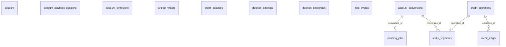
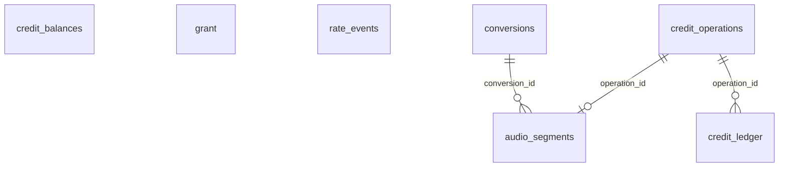

# Durable Object database schemas

Cup keeps application state in three kinds of SQLite stores: one per account, one per conversion grant, and the singleton registry. Each Durable Object instance has its own database; identifiers shared between stores do not establish cross-database foreign keys. See [storage ownership](README.md#storage-ownership) for how the objects cooperate.

The Drizzle schemas linked in each section define the columns, types, constraints, and indexes. The diagrams are generated from those schemas by each owning library's `migrations:generate`: they name every table and draw each declared foreign key from the referenced table to the referencing one, labelled with the referencing columns, as one-to-one when those columns are unique in the referencing table. Do not edit them by hand; each library's `sqlite-migrations.test.ts` fails when its diagram differs from the generated one, next to the check that the schema matches its latest migration snapshot.

All three stores keep their own `rate_events` table from the [rolling limits library](../../libs/rolling-limits/README.md).

## Naming conventions

The account and conversion grant objects share one definition of their [duration ledger and audio segment tables](../../libs/duration-ledger/src/duration-ledger-schema.ts). Their conversion tables keep owner-specific names, `account_conversions` and `conversions`, because their columns differ, but a column that records the same fact has the same name in both. Column names end in a suffix that states the unit:

- A point in time is an integer of Unix epoch milliseconds whose name ends in `_at_ms`, such as `created_at_ms`. A row's creation time is `created_at_ms`.
- A duration is an integer of milliseconds whose name ends in `_milliseconds`, such as `offset_milliseconds`.
- A JSON column ends in `_json`.

Existing columns that predate this convention keep their names until a migration has another reason to rebuild their table: `recovery_deadline_ms` and `next_attempt_ms` are points in time, the ledger's `amount`, `available`, `reserved`, and delta columns are durations in their `unit`, `audio-millisecond`, and the registry's `registry_grants.projection_reserved` and `projection_spent` are durations in milliseconds. The ledger tables keep their `credit_` prefix from before the [duration ledger](../GLOSSARY.md#duration-ledger) was named.

## Account object

`AccountDurableObject`. Each account has an isolated database for identity and lifecycle state, conversion history, listening positions, dispatch, duration accounting, artifact writers, and deletion confirmation. The account owns the rows through its Durable Object identity; no table has a foreign key to the singleton `account` row.

`account_playback_positions` has no foreign key to `account_conversions` because signed-in listeners can save listening positions for trial audiobooks that they do not own but are authorized to access through the owning grant. See [position restoration and saves](conversion.md#delivery-positions-and-lifecycle) for player behavior.

Writers may target pending or ready conversions; account lifecycle and execution epochs fence their storage effects.

`account_conversions.deleting_since_ms` is the conversion deletion marker; the account alarm stays armed while any row carries it and deletes the conversion's rows, the marked row last; `workflow_termination_tried_at_ms` records that the alarm took the conversion's one attempt to terminate its workflows ([conversion deletion](conversion-deletion.md)).

`registry_confirmed_revision` records the duration ledger revision for which the registry confirmed the account's [usage projection](#registry). The revision is the number of ledger events, so every change to the allowance, reserved duration, or spent duration advances it without a separate counter.

Sources: [account-sqlite-schema.ts](../../libs/accounts/src/storage/account-sqlite-schema.ts), [rate-limit-schema.ts](../../libs/rolling-limits/src/rate-limit-schema.ts), [duration-ledger-schema.ts](../../libs/duration-ledger/src/duration-ledger-schema.ts); [migrations](../../libs/accounts/drizzle/account/).

<!-- schema-diagram:account -->

[Open this diagram in Mermaid Live](https://mermaid.live/view#pako:eJyFkVFuwyAQRK-C9tu5gL97isoSWsOG0AKL1us0lZ27V7RuWkdV8wc7b4ZZsYBjT9ADyVPEIJiHYowx6BzPRXcXWxO-j-hebeUpauQy7XXlPE7KhbaxaDyiU_smUUk22An5qHbEhMXRNvSUqAVaVKVc9X7sTpgSlfDNCypZOlPRuwqOy5lkat3Muh4OvBicfWQ7UcgNN70Z4Iey0Q_wIGI1lYqPJdgXHv8J2DbjSoL6u8EmJPKB5NN_Yx7b178W2Puhg0ySMXroYWlpA-iJMg3QYCE_Xw6OE0t76wodzNWj0vbj0KvM1EGQFvB1rliemW-S8BxO0B8xTXT9ANPKyc0)

<!-- /schema-diagram:account -->

## Conversion grant object

`ConversionGrantDurableObject`. Each conversion grant has an isolated database for its credentials, session signing state, conversions, duration ledger, and start-rate accounting. The singleton `grant` row owns conversions through the Durable Object identity rather than a `grant_id` foreign key in the conversions table. The grant's allowance, reservations, and charges live in the same ledger tables as an account's; the allowance is the sum of its grant and adjustment events.

Both owners store a conversion's outcome and its last started [preparation phase](../GLOSSARY.md#preparation-phase) in typed columns with the same names. Only grants keep `workflow_started_at_ms`, measurements, provider usage, diagnostic references, and `cleanup_state`: they serve the operator's inspection of trial conversions and the grant's own cleanup of failed artifacts, while account conversions are reconciled through dispatch jobs and artifact writers and their artifacts are removed by [conversion deletion](conversion-deletion.md) or account erasure. Grant failure categories are limited to the conversion failure categories; account failures also record `execution-failed`.

Sources: [grant-sqlite-schema.ts](../../libs/conversion-grants/src/storage/grant-sqlite-schema.ts), [rate-limit-schema.ts](../../libs/rolling-limits/src/rate-limit-schema.ts), [duration-ledger-schema.ts](../../libs/duration-ledger/src/duration-ledger-schema.ts); [migrations](../../libs/conversion-grants/drizzle/grant/).

<!-- schema-diagram:grant -->

[Open this diagram in Mermaid Live](https://mermaid.live/view#pako:eJyFkFFqwzAQRK8i9tu-gL57iiIwW2mqCGytWUmhYOfuQbVJEwj0b9h5MwO7kZcAsgT9SByVF5eNMcYrQqrTF8-cPcpxjMq5HlK5YsIVuZ6el3yFliS5mH0fR9kMt5BkKohLx4w1jv6oKQVHL1uyQrk-F5zGjBChv_kH8398f7f_mqeBFujCKZClrbc5qhcscNRhRWg_o5dZtG_daKC2Bq44P0W2asNAUXvBoVfOnyIPS6XFC9lvngtudw_Of-w)

<!-- /schema-diagram:grant -->

## Registry

`RegistryDurableObject`. One preserved singleton database stores grant inventory, account identity mappings and coordination, ingress rate limits, and conversion ownership for accounts and trials. `conversion_owners` is the sole conversion ownership mapping; a check constraint requires exactly the owner identifier appropriate to `owner_kind`. Account identifiers refer to separate Durable Object databases, so the registry declares no foreign keys. Subject and deletion-attempt identifiers are coordinated by application logic, including records that outlive erased accounts.

The `projection_*` columns of `registry_grants` and `identity_accounts` are [usage projections](../GLOSSARY.md#usage-projection), which the code calls snapshots: copies of each owner's allowance, reserved duration, and spent duration that let the operator list grants and accounts from this one database instead of calling every owner object. The owner object stays authoritative. Each projection carries the owner's revision, and the registry keeps only the newest: an older revision is ignored as stale, and a repeated revision must match what is stored (the registry's `accounts.test.ts` and `durable-objects.test.ts` cover both). The owner records the revision the registry confirmed and retries from its alarm until the registry has confirmed the current one. Grants count their own revisions; an account's revision is its duration ledger's event count. The registry also pulls usage from an account when provisioning activates it, and its alarm backfills active accounts whose projection is still missing. A projection disappears with its identity mapping when account deletion completes.

Sources: [registry-sqlite-schema.ts](../../libs/registry/src/storage/registry-sqlite-schema.ts), [rate-limit-schema.ts](../../libs/rolling-limits/src/rate-limit-schema.ts); [migrations](../../libs/registry/drizzle/registry/).

<!-- schema-diagram:registry -->

[Open this diagram in Mermaid Live](https://mermaid.live/view#pako:eJxdkFFqw0AMRK9i9O1ewN89RVkw6u5ko2JLRpbdhpC7h6WuKfmT5g0zMHfKVkADwd-Fq_OctOu6LrNmTChjwYQQ05EjMC-xHtx0h68N2LfCD_l0f9nnq6QWcpHM7Xlljgw5w6VAQ-I2cs626Z-8uO3SKkXrvwLnwIgdp89RZQ2_jdVZY6WeZvjMUmige7MkiitmJBq6RI6y_bxlm8wTJX1QT9tSOHDsQUP4hp6qt4Dfe2H9MDuR21avNFx4WvF4AoRdeMI)

<!-- /schema-diagram:registry -->

## Migration metadata

Every store also has Drizzle's internal `__drizzle_migrations` table, created by the Durable SQLite migrator rather than the application schema. It tracks applied migration timestamps and hashes independently in each database. The [account migration entry point](../../libs/accounts/src/storage/sqlite-migrations.ts), [grant migration entry point](../../libs/conversion-grants/src/storage/legacy-grant-migrations.ts), and [registry migration entry point](../../libs/registry/src/storage/sqlite-migrations.ts) invoke that migrator.
